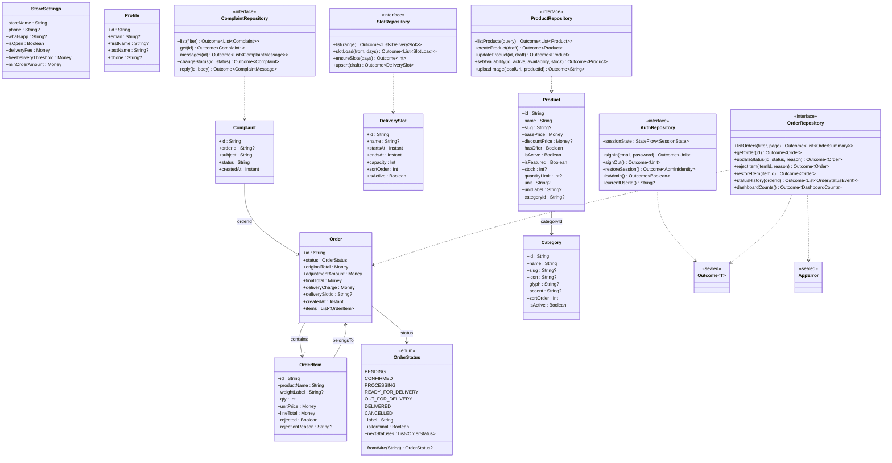

# ARCHITECTURE — Vedant Admin (Android)

**System design + ordered task decomposition for the store-owner operations console.**

| Field | Value |
|---|---|
| Document | `docs/ARCHITECTURE.md` (SOP stage 2 — architecture & planning) |
| Owner (Architect) | 高见远 (Gao) |
| Upstream | `docs/PRD.md` v1 (PM 许清楚), `CLAUDE.md`, live Supabase schema |
| Backend | Supabase project `hyibaljxicojfoxbihdn` (shared with the customer PWA) |
| Platform | Kotlin 2.0.20 · Compose (Material 3) · single `:app` module |
| Toolchain | AGP 8.7.3 / Gradle 8.12 / compileSdk 35 / minSdk 26 / targetSdk 35 / JDK 17 |
| Language | English |
| Status | Design-complete; legacy/duplicate column policy resolved for all 6 pairs (pair 5 closed by **T01** evidence; pair 3 write-both with a non-blocking **T02** confirmation). Phase-0 contract recorded in `docs/CONTRACT.md` + `docs/SCHEMA_SNAPSHOT.md`. |

> **Binding principle (from PRD §0).** The live database is the *only* schema authority. Where
> `docs/BACKEND_CONTRACT.md`, `src/types/database.ts`, `HANDOVER.md` or `PROJECT_INDEX.md`
> disagree with the live DB, the live DB wins and the doc is a defect. Nothing in this design may
> assume a column exists or is authoritative without a stated evidence basis.

---

## 1. Architecture overview

### 1.1 Layer diagram

```
┌──────────────────────────────────────────────────────────────────────────────┐
│  PRESENTATION  (Android/Compose only)                                          │
│  feature-*/  →  Screen (composable, stateless)  +  ViewModel (StateFlow<UiState>)│
│  ui/theme (existing)  ·  ui/components (shared)  ·  ui/navigation (NavHost)     │
│  Rules: no business logic in composables; no Supabase import; one-shot Events   │
└───────────────▲───────────────────────────────────────────────┬───────────────┘
                │ StateFlow<UiState>            Event / intent │
┌───────────────┴───────────────────────────────────────────────▼───────────────┐
│  DOMAIN  (pure Kotlin — no Android, no Supabase, no Ktor imports)              │
│  domain/model  (Order, Product, … , Money, OrderStatus)                        │
│  domain/repository  (interfaces only)                                          │
│  domain/usecase  (order state machine, validation, pricing-display rules)      │
│  Types: Outcome<T> = Success | Failure(AppError)                               │
└───────────────▲───────────────────────────────────────────────┬───────────────┘
                │ domain models                 Outcome / calls│
┌───────────────┴───────────────────────────────────────────────▼───────────────┐
│  DATA  (the only layer that imports the Supabase SDK)                          │
│  data/remote/dto      (kotlinx.serialization DTOs — wire shape, incl. legacy)   │
│  data/remote/mapper   (DTO ↔ domain; dual-column policy lives here)             │
│  data/repository      (…RepositoryImpl : domain interface)                      │
│  data/local           (Phase 5: DataStore JSON snapshot cache)                   │
│  data/session         (SessionStore — token/user, not UI)                        │
└───────────────▲───────────────────────────────────────────────┬───────────────┘
                │                                SDK calls      │
┌───────────────┴───────────────────────────────────────────────▼───────────────┐
│  SUPABASE  ·  PostgREST  ·  GoTrue(Auth)  ·  Storage                           │
│  RLS + private.is_admin() are the ONLY authorization gate.                     │
└────────────────────────────────────────────────────────────────────────────────┘
```

### 1.2 Why this layering holds

1. **One-way dependency.** Presentation → Domain → Data → Supabase. Domain depends on nothing
   platform-specific, so it is unit-testable on the JVM (P2-4) and survives a future Hilt swap
   (the brief forbids Hilt/KSP *now*; `di/` is the seam, per `CLAUDE.md`).
2. **The SDK is quarantined in `data/`.** `CLAUDE.md` rule: "No Supabase calls from UI." Only
   `*RepositoryImpl` and `data/remote/*` import `io.github.jan-tennert.supabase`.
3. **"Never fake success" is structural, not a discipline.** Repositories return only
   server-confirmed values. A mutation returns the *re-fetched server row*; there is no code path
   that constructs an `Order`/`final_total` locally, so an optimistic UI is not expressible
   without writing new code that would fail review.
4. **Wire truth is isolated in DTOs.** Postgres enum names, `qty` (not `quantity`), and every
   legacy/duplicate column appear only in DTOs and mappers. Domain models never carry a legacy
   field name, so the "dual column" hazard cannot leak upward.

### 1.3 Data flow (one mutation, end to end)

```
Screen.onAccept(orderId)
  → OrderDetailViewModel.accept()            // sets actionState = InFlight; blocks re-entry
    → OrderRepository.updateStatus(orderId, CONFIRMED, null)
      → AdminRpc.adminUpdateOrderStatus(...)  // PostgREST RPC — server validates transition
        (server rejects → RestException 42501/22023)
      → OrderRepository.getOrder(orderId)     // RE-FETCH; never trust a local guess
    ← Outcome<Order> (server-confirmed final_total, status, items)
  → ViewModel emits new immutable UiState + a one-shot Event (snackbar/nav)
  → Screen renders exactly what the server returned
```

On failure: `Outcome.Failure(AppError)` → mapped copy shown, **`actionState` returns to Idle,
`order` is unchanged** — the UI does not move.

---

## 2. Package / file layout

Everything under `admin-android/app/src/main/java/com/vedant/admin/` unless noted. **Existing
files are preserved; new files are added around them.**

> **Naming note (as built).** Where the tree below names a file, the name is the *as-built* name.
> Two entries intentionally differ from an earlier draft and are recorded here so they are not
> mistaken for missing files: the weight screen is `feature/catalogue/weights/WeightsScreen.kt` with
> `WeightsViewModel`/`WeightsUiState` (not `WeightVariants*`), and the signed-in identity model is
> `domain/model/OperatorProfile.kt` with `AdminIdentity.kt` as the session identity (there is no
> `Profile.kt`). A couple of files below also exist that the design did not name, e.g.
> `data/remote/*RemoteSource.kt` (the per-feature RestApi seam) and `core/network/ConnectivityObserver.kt`
> — those are additions, not substitutions.

```
com.vedant.admin
├── MainActivity.kt                          (EXISTING — modify: host NavHost instead of BuildCheck)
├── VedantAdminApplication.kt                (NEW — creates AppContainer, registered in manifest)
│
├── core/                                     NEW — no Android UI, no Supabase
│   ├── money/Money.kt                         value class Money(Long paise) + format/parse
│   ├── money/MoneySerializer.kt               KSerializer reading JsonPrimitive.content → paise
│   ├── result/Outcome.kt                      sealed Outcome<T> = Success | Failure
│   ├── error/AppError.kt                      sealed error taxonomy (see §9)
│   ├── error/ErrorMapper.kt                   Throwable/PostgrestException → AppError
│   ├── error/ErrorCopy.kt                     AppError → user-facing string (no raw codes)
│   ├── time/AppClock.kt                       Asia/Kolkata display + UTC storage helpers
│   └── logging/AppLog.kt                      redacting logger (never logs tokens/PII)
│
├── domain/
│   ├── model/
│   │   ├── OrderStatus.kt                    (EXISTING — keep verbatim)
│   │   ├── Order.kt                          Order, OrderItem, OrderStatusEvent
│   │   ├── OrderSummary.kt                   list-row projection
│   │   ├── DashboardCounts.kt                counts by status (today)
│   │   ├── Product.kt                        Product + ProductDraft (dual-column aware)
│   │   ├── Category.kt                       Category + CategoryDraft
│   │   ├── ProductWeight.kt                  ProductWeight + draft
│   │   ├── Offer.kt                          Offer + draft
│   │   ├── DeliverySlot.kt                   DeliverySlot + SlotLoad + draft
│   │   ├── Complaint.kt                      Complaint, ComplaintMessage, ComplaintStatus, ComplaintType
│   │   ├── StoreSettings.kt                  StoreSettings + draft
│   │   ├── Profile.kt                        Profile + AdminIdentity
│   │   └── OrderFilter.kt                    status filter / search / page model
│   ├── repository/                           interfaces only (see §6)
│   │   ├── AuthRepository.kt  OrderRepository.kt  ProductRepository.kt
│   │   ├── CategoryRepository.kt  WeightRepository.kt  OfferRepository.kt
│   │   ├── SlotRepository.kt  ComplaintRepository.kt
│   │   └── StoreSettingsRepository.kt  ProfileRepository.kt
│   └── usecase/
│       ├── OrderTransitions.kt               allowed next states (mirrors server, UI hint only)
│       ├── OrderMoney.kt                     display-only money formatting from server values
│       └── Validation.kt                     product/slot/settings field validation
│
├── data/
│   ├── remote/
│   │   ├── SupabaseProvider.kt               createSupabaseClient(...) from BuildConfig
│   │   ├── AdminRpc.kt                       typed wrappers over the 8 admin RPCs
│   │   ├── StorageDataSource.kt              upload to product-images / complaint-images
│   │   ├── dto/  (wire shape — legacy columns live HERE only)
│   │   │   ├── OrderDto.kt  OrderItemDto.kt  OrderStatusHistoryDto.kt
│   │   │   ├── ProductDto.kt  CategoryDto.kt  ProductWeightDto.kt  OfferDto.kt
│   │   │   ├── DeliverySlotDto.kt  SlotLoadDto.kt
│   │   │   ├── ComplaintDto.kt  ComplaintMessageDto.kt  ComplaintAttachmentDto.kt
│   │   │   ├── StoreSettingsDto.kt  ProfileDto.kt
│   │   │   └── AuthDtos.kt                   session/identity helpers
│   │   └── mapper/
│   │       ├── OrderMapper.kt                incl. delivery_slot_id→slot_id fallback
│   │       ├── CatalogueMapper.kt            incl. price/base_price, quantity_limit/max_order_qty
│   │       ├── SlotMapper.kt                 incl. starts_at/ends_at vs start_time/end_time
│   │       └── SupportMapper.kt  SettingsMapper.kt  ProfileMapper.kt
│   ├── repository/                           *RepositoryImpl for every domain interface
│   │   ├── AuthRepositoryImpl.kt  OrderRepositoryImpl.kt  ProductRepositoryImpl.kt
│   │   ├── CategoryRepositoryImpl.kt  WeightRepositoryImpl.kt  OfferRepositoryImpl.kt
│   │   ├── SlotRepositoryImpl.kt  ComplaintRepositoryImpl.kt
│   │   └── StoreSettingsRepositoryImpl.kt  ProfileRepositoryImpl.kt
│   ├── session/SessionStore.kt               StateFlow<SessionState>; wraps supabase auth state
│   └── local/CacheStore.kt                   (Phase 5) DataStore JSON snapshots — NOT Room
│
├── di/
│   ├── AppContainer.kt                       builds supabase client + all repositories
│   └── ViewModelFactory.kt                   AppViewModelFactory(container) : ViewModelProvider.Factory
│
├── ui/
│   ├── theme/                                (EXISTING — Color/Type/Spacing/Theme, untouched)
│   ├── components/
│   │   ├── StateScaffold.kt                  Loading / Empty / Error / Offline banner primitives
│   │   ├── StatusBadge.kt                    word + icon shape + colour (WCAG 1.4.1)
│   │   ├── VedantTopBar.kt                   app bar with icon-only actions + contentDescription
│   │   └── VedantButtons.kt                  PrimaryButton with in-flight spinner + double-submit block
│   └── navigation/
│       ├── Routes.kt                         route constants + argument keys
│       ├── VedantNavHost.kt                  NavHost + auth/admin guards
│       └── SessionViewModel.kt               app-level session/gate state (StateFlow)
│
└── feature/
    ├── auth/       SplashScreen/ViewModel/UiState · SignInScreen/ViewModel/UiState
    │               NotAuthorizedScreen/ViewModel/UiState
    ├── dashboard/  DashboardScreen/ViewModel/UiState
    ├── orders/     list/OrdersListScreen|ViewModel|UiState
    │               detail/OrderDetailScreen|ViewModel|UiState · RejectItemSheet.kt
    ├── catalogue/  hub/CatalogueHubScreen|ViewModel|UiState
    │               editor/ProductEditorScreen|ViewModel|UiState
    │               categories/CategoriesScreen|ViewModel|UiState
    │               weights/WeightsScreen|ViewModel|UiState        (as built — not "WeightVariants")
    │               offers/OffersScreen|ViewModel|UiState
    ├── slots/      SlotsScreen|ViewModel|UiState
    ├── support/    list/ComplaintsListScreen|ViewModel|UiState
    │               thread/ComplaintThreadScreen|ViewModel|UiState
    └── settings/   store/StoreSettingsScreen|ViewModel|UiState
                    profile/ProfileScreen|ViewModel|UiState
```

---

## 3. Supabase client design

**Location:** `data/remote/SupabaseProvider.kt`. Constructed **once** in `AppContainer` and injected
downward. No composable and no ViewModel ever calls `createSupabaseClient`.

```kotlin
// data/remote/SupabaseProvider.kt
object SupabaseProvider {
    fun create(): SupabaseClient = createSupabaseClient(
        supabaseUrl = BuildConfig.SUPABASE_URL,      // publishable only
        supabaseKey = BuildConfig.SUPABASE_ANON_KEY, // publishable only
    ) {
        install(Auth) {
            // Persistent session across process death. Backed by SharedPreferences.
            sessionManager = SettingsSessionManager(settings = Settings()) // multiplatform-settings
            autoLoadFromStorage = true
            alwaysAutoRefresh = true
        }
        install(Postgrest)
        install(Storage)
    }
}
```

- **Key hygiene.** Only `BuildConfig.SUPABASE_URL` / `SUPABASE_ANON_KEY` are read. The
  service-role key is never referenced. Enforced by a static test (T12, P0-11).
- **Session persistence.** `SettingsSessionManager` (from `multiplatform-settings-no-arg`) persists
  the refresh token so a killed process restores the session. **Do not** roll a hand-written token
  store. (Exact 3.0.3 property names — `sessionManager`, `autoLoadFromStorage`, `alwaysAutoRefresh`
  — are confirmed during T06 against the SDK API; the design intent is fixed, only the spelling may
  adjust.)
- **Plugins installed:** `Auth` (GoTrue), `Postgrest`, `Storage`. `Realtime` is **not** installed
  (not required by the PRD; avoids a socket dependency).
- **Kept out of the UI:** the `SupabaseClient` instance lives inside `AppContainer`; only
  `*RepositoryImpl` receives it. `feature/*` and `ui/*` never import `io.github.jan-tennert.*`.

---

## 4. DI container design

**Hand-rolled, no Hilt, no KSP** (explicit brief + `CLAUDE.md`). Two files.

```kotlin
// di/AppContainer.kt — created in VedantAdminApplication.onCreate()
class AppContainer(private val app: Application) {
    val supabase: SupabaseClient by lazy { SupabaseProvider.create() }
    val sessionStore: SessionStore by lazy { SessionStore(supabase) }

    val authRepository: AuthRepository               by lazy { AuthRepositoryImpl(supabase, sessionStore) }
    val orderRepository: OrderRepository             by lazy { OrderRepositoryImpl(supabase) }
    val productRepository: ProductRepository         by lazy { ProductRepositoryImpl(supabase) }
    val categoryRepository: CategoryRepository       by lazy { CategoryRepositoryImpl(supabase) }
    val weightRepository: WeightRepository           by lazy { WeightRepositoryImpl(supabase) }
    val offerRepository: OfferRepository             by lazy { OfferRepositoryImpl(supabase) }
    val slotRepository: SlotRepository               by lazy { SlotRepositoryImpl(supabase) }
    val complaintRepository: ComplaintRepository     by lazy { ComplaintRepositoryImpl(supabase) }
    val settingsRepository: StoreSettingsRepository  by lazy { StoreSettingsRepositoryImpl(supabase) }
    val profileRepository: ProfileRepository         by lazy { ProfileRepositoryImpl(supabase) }
    val storage: StorageDataSource                   by lazy { StorageDataSource(supabase) }
    // Phase 5: val cacheStore: CacheStore by lazy { CacheStore(app) }
}
```

```kotlin
// di/ViewModelFactory.kt
class AppViewModelFactory(private val c: AppContainer) : ViewModelProvider.Factory {
    override fun <T : ViewModel> create(modelClass: Class<T>): T = when {
        modelClass.isAssignableFrom(OrdersListViewModel::class.java) ->
            OrdersListViewModel(c.orderRepository) as T
        // …one branch per ViewModel…
        else -> error("Unknown ViewModel: ${modelClass.name}")
    }
}
```

**How a ViewModel gets a repository.** `AppContainer` is held by the `Application`
(`VedantAdminApplication.container`). `MainActivity` builds one `AppViewModelFactory(container)` and
passes it to `viewModel(factory = …)` at each NavHost destination. Constructor injection only —
ViewModels take repository interfaces, never the SDK. This keeps the Hilt swap a one-file change
(`di/`) and keeps `androidTest` able to inject fakes.

---

## 5. Domain models & mappers

### 5.1 Money representation

Postgres stores money as `numeric(12,2)`. **The client never uses `Double` for money.**

```kotlin
// core/money/Money.kt
@JvmInline
value class Money(val paise: Long) : Comparable<Money> {
    companion object {
        val ZERO = Money(0)
        /** Parses "152", "152.0", "152.00", "-132.50" without float rounding. */
        fun parse(text: String): Money
    }
    fun format(): String = "₹" + … // display only; never re-parsed for arithmetic that is sent
}
```

- `MoneySerializer` (a `KSerializer<Money>`) reads the raw literal via `JsonPrimitive.content`, so it
  works whether PostgREST emits `152`, `152.0` or `"152.00"`. Integer paise end-to-end ⇒ no float
  drift and parity with the PWA's `src/lib/money.ts`.
- **Money is display-only in this app.** `final_total`, `original_total`, `adjustment_amount`,
  `line_total`, `unit_price` are **rendered exactly as the server returned them**. The client never
  computes an amount and sends it — `admin_reject_order_item` / `admin_restore_order_item` accept no
  amount (PRD §0.5, `CLAUDE.md` rule 5). The server recomputes and we re-fetch.

### 5.2 Enum handling

- **Wire values are the Postgres enum names.** `OrderStatus.kt` (existing) already mirrors them and
  provides `label`, `isTerminal`, `nextStatuses`, and a tolerant `fromWire()`. Keep it verbatim.
- `ComplaintStatus` = `OPEN | IN_PROGRESS | RESOLVED | CLOSED` (live; the stale `IN_REVIEW` is a
  defect). `ComplaintType` = `WRONG_ITEM | DAMAGED | MISSING_ITEM | LATE_DELIVERY | QUALITY | OTHER`.
- **Tolerant decode is mandatory.** Unknown enum values must never crash a list: DTO fields that are
  enums are declared as `String` and mapped via a `fromWire()` that returns `null` for unknowns; the
  UI shows the raw value with a neutral badge rather than throwing.

### 5.3 DTO ↔ domain mapping rules

| Rule | Detail |
|---|---|
| DTOs mirror the wire **exactly**, including legacy columns | `OrderDto` has both `slot_id` and `delivery_slot_id`; `ProductDto` has both `price` and `base_price`, `quantity_limit` and `max_order_qty`. |
| Domain models carry **one** field per concept | `Order.deliverySlotId: String?`; `Product.basePrice: Money`; `Product.quantityLimit: Int?`. |
| Legacy/duplicate policy is applied **in the mapper only** (§10) | `ProductDto.basePrice ?: ProductDto.price` → `Product.basePrice`. |
| Timestamps | DTOs keep ISO-8601 strings; mappers convert to `kotlinx.datetime.Instant`; display converts to `Asia/Kolkata` (§13). |
| Nullability | A nullable DB column maps to a nullable domain field; never coalesce to a fake default that could be mistaken for server truth. |
| Money | `@Serializable(with = MoneySerializer::class)` on every money field. |

### 5.4 Class diagram



*(The full typed interface set — Category/Weight/Offer/StoreSettings/Profile — is enumerated in §6.
A copy of this diagram is written to `docs/class-diagram.mermaid`.)*

---

## 6. Repository interfaces

All methods return `Outcome<T>` (§9). All are `suspend` except the flow/identity accessors.

```kotlin
// domain/repository/AuthRepository.kt
interface AuthRepository {
    val sessionState: StateFlow<SessionState>            // Unknown|SignedOut|SignedIn|NotAuthorized
    suspend fun signIn(email: String, password: String): Outcome<Unit>
    suspend fun signOut(): Outcome<Unit>
    suspend fun restoreSession(): Outcome<AdminIdentity> // loads session + resolves is_admin()
    suspend fun isAdmin(): Outcome<Boolean>              // server gate: RPC is_admin()
    suspend fun currentUserId(): String?                 // for storage path <auth.uid()>/<file>
    suspend fun currentAccessToken(): String?            // for authenticated Storage uploads
}

// domain/repository/OrderRepository.kt
interface OrderRepository {
    suspend fun listOrders(filter: OrderFilter, page: Int, pageSize: Int = 20): Outcome<List<OrderSummary>>
    suspend fun getOrder(orderId: String): Outcome<Order>
    suspend fun updateStatus(orderId: String, status: OrderStatus, reason: String?): Outcome<Order>
    suspend fun rejectItem(itemId: String, reason: String): Outcome<Order>
    suspend fun restoreItem(itemId: String): Outcome<Order>
    suspend fun statusHistory(orderId: String): Outcome<List<OrderStatusEvent>>
    suspend fun dashboardCounts(): Outcome<DashboardCounts>
}

// domain/repository/ProductRepository.kt
interface ProductRepository {
    suspend fun listProducts(query: ProductQuery): Outcome<List<Product>>
    suspend fun getProduct(id: String): Outcome<Product>
    suspend fun createProduct(draft: ProductDraft): Outcome<Product>
    suspend fun updateProduct(id: String, draft: ProductDraft): Outcome<Product>
    suspend fun setAvailability(id: String, isActive: Boolean, availability: String?, stock: Int?): Outcome<Product>
    suspend fun uploadImage(localUri: String, productId: String): Outcome<String> // → public URL
}

// domain/repository/CategoryRepository.kt
interface CategoryRepository {
    suspend fun listCategories(): Outcome<List<Category>>
    suspend fun createCategory(draft: CategoryDraft): Outcome<Category>
    suspend fun updateCategory(id: String, draft: CategoryDraft): Outcome<Category>
    suspend fun setActive(id: String, isActive: Boolean): Outcome<Category>
}

// domain/repository/WeightRepository.kt
interface WeightRepository {
    suspend fun listWeights(productId: String): Outcome<List<ProductWeight>>
    suspend fun upsertWeight(productId: String, draft: ProductWeightDraft): Outcome<ProductWeight>
    suspend fun deleteWeight(weightId: String): Outcome<Unit>
}

// domain/repository/OfferRepository.kt
interface OfferRepository {
    suspend fun listOffers(productId: String?): Outcome<List<Offer>>
    suspend fun upsertOffer(draft: OfferDraft): Outcome<Offer>
    suspend fun setActive(offerId: String, isActive: Boolean): Outcome<Offer>
    suspend fun deleteOffer(offerId: String): Outcome<Unit>
}

// domain/repository/SlotRepository.kt
interface SlotRepository {
    suspend fun listSlots(from: Instant, days: Int): Outcome<List<DeliverySlot>>
    suspend fun slotLoad(from: Instant, days: Int): Outcome<List<SlotLoad>>   // RPC admin_slot_load
    suspend fun ensureSlots(days: Int): Outcome<Int>                          // RPC ensure_delivery_slots
    suspend fun upsertSlot(draft: DeliverySlotDraft): Outcome<DeliverySlot>
    suspend fun setActive(slotId: String, isActive: Boolean): Outcome<DeliverySlot>
}

// domain/repository/ComplaintRepository.kt
interface ComplaintRepository {
    suspend fun listComplaints(filter: ComplaintFilter): Outcome<List<Complaint>>
    suspend fun getComplaint(id: String): Outcome<Complaint>
    suspend fun listMessages(complaintId: String): Outcome<List<ComplaintMessage>>
    suspend fun changeStatus(complaintId: String, status: String): Outcome<Complaint>
    suspend fun reply(complaintId: String, body: String): Outcome<ComplaintMessage>
    suspend fun listAttachments(complaintId: String): Outcome<List<ComplaintAttachment>>
}

// domain/repository/StoreSettingsRepository.kt
interface StoreSettingsRepository {
    suspend fun getSettings(): Outcome<StoreSettings>
    suspend fun updateSettings(draft: StoreSettingsDraft): Outcome<StoreSettings>
}

// domain/repository/ProfileRepository.kt
interface ProfileRepository {
    suspend fun me(): Outcome<Profile>
    suspend fun updateProfile(draft: ProfileDraft): Outcome<Profile>
    suspend fun listAdmins(): Outcome<List<AdminIdentity>>   // RPC admin_list_admins
}
```

**Note on mutation return values.** Every mutation returns the **re-fetched server row**
(`Outcome<Order>` etc.), not the request. This is how "never fake success" is enforced in code: the
ViewModel has nothing to render until the server answers.

---

## 7. Navigation graph

`ui/navigation/Routes.kt` holds constants; `ui/navigation/VedantNavHost.kt` wires the graph.

| Route | Arguments | Screen | Guard |
|---|---|---|---|
| `splash` (start) | — | S1 Splash | none (entry point) |
| `signin` | — | S2 Sign in | only reachable when `SignedOut` |
| `not_authorized` | — | S3 Not authorized | only when `NotAuthorized` |
| `dashboard` | — | S4 Dashboard | **admin** |
| `orders?status={status}` | `status: String?` | S5 Orders list | admin |
| `orders/{orderId}` | `orderId: String` | S6 Order detail | admin |
| `catalogue` | — | S8 Catalogue hub | admin |
| `catalogue/products/{productId}` | `productId: String` (`"new"` = create) | S9 Product editor | admin |
| `catalogue/categories` | — | S10 Categories | admin |
| `catalogue/products/{productId}/weights` | `productId: String` | S11 Weight variants | admin |
| `catalogue/offers` | — | S12 Offers | admin |
| `slots` | — | S13 Delivery slots | admin |
| `complaints` | — | S14 Complaints list | admin |
| `complaints/{complaintId}` | `complaintId: String` | S15 Complaint thread | admin |
| `settings` | — | S16 Store settings | admin |
| `profile` | — | S17 Profile / session | admin |

### 7.1 Guards & session restore

- A single `SessionViewModel` (scoped to the activity) exposes `StateFlow<SessionState>`:
  `Unknown | SignedOut | SignedIn(userId, email) | NotAuthorized`.
- `VedantNavHost` observes it and performs **declarative redirects**:
  - `Unknown` → stay on `splash` (spinner).
  - `SignedOut` → `signin`.
  - `NotAuthorized` → `not_authorized` (renders a refusal screen with **no admin data** and a
    sign-out action).
  - `SignedIn` → `dashboard`.
- **Splash/session-restore entry:** `splash` calls `AuthRepository.restoreSession()`, which
  auto-loads the persisted session and then calls the **server** `is_admin()` RPC. Only a
  server-confirmed `true` yields `SignedIn`; `false` yields `NotAuthorized`. A locally cached role is
  never consulted (CLAUDE.md rule 2).
- **Back-stack rules:**
  - On sign-in success: `navigate("dashboard") { popUpTo("splash") { inclusive = true } }` — splash
    and signin are removed.
  - On sign-out: `navigate("signin") { popUpTo(0) { inclusive = true } }` — the whole admin stack is
    cleared so back never reveals admin screens.
  - `not_authorized` is a dead end: back exits the app; the only action is sign out.
  - Detail/editor screens are ordinary pushes (system back returns to the list).

---

## 8. Screen inventory mapping (S1–S17)

| # | PRD Screen | Composable | ViewModel | UiState |
|---|---|---|---|---|
| S1 | Splash / session check | `feature/auth/SplashScreen.kt` | `SplashViewModel` | `SplashUiState` + app-level `SessionState` |
| S2 | Sign in | `feature/auth/SignInScreen.kt` | `SignInViewModel` | `SignInUiState` |
| S3 | Not authorized | `feature/auth/NotAuthorizedScreen.kt` | `NotAuthorizedViewModel` | `NotAuthorizedUiState` |
| S4 | Dashboard | `feature/dashboard/DashboardScreen.kt` | `DashboardViewModel` | `DashboardUiState` |
| S5 | Orders list | `feature/orders/list/OrdersListScreen.kt` | `OrdersListViewModel` | `OrdersListUiState` |
| S6 | Order detail | `feature/orders/detail/OrderDetailScreen.kt` | `OrderDetailViewModel` | `OrderDetailUiState` |
| S7 | Reject item sheet | `feature/orders/detail/RejectItemSheet.kt` | *(uses `OrderDetailViewModel`)* | part of `OrderDetailUiState` |
| S8 | Catalogue hub | `feature/catalogue/hub/CatalogueHubScreen.kt` | `CatalogueViewModel` | `CatalogueUiState` |
| S9 | Product editor | `feature/catalogue/editor/ProductEditorScreen.kt` | `ProductEditorViewModel` | `ProductEditorUiState` |
| S10 | Categories | `feature/catalogue/categories/CategoriesScreen.kt` | `CategoriesViewModel` | `CategoriesUiState` |
| S11 | Weight variants | `feature/catalogue/weights/WeightsScreen.kt` | `WeightsViewModel` | `WeightsUiState` |
| S12 | Offers | `feature/catalogue/offers/OffersScreen.kt` | `OffersViewModel` | `OffersUiState` |
| S13 | Delivery slots | `feature/slots/SlotsScreen.kt` | `SlotsViewModel` | `SlotsUiState` |
| S14 | Complaints list | `feature/support/list/ComplaintsListScreen.kt` | `ComplaintsListViewModel` | `ComplaintsListUiState` |
| S15 | Complaint thread | `feature/support/thread/ComplaintThreadScreen.kt` | `ComplaintThreadViewModel` | `ComplaintThreadUiState` |
| S16 | Store settings | `feature/settings/store/StoreSettingsScreen.kt` | `StoreSettingsViewModel` | `StoreSettingsUiState` |
| S17 | Profile / session | `feature/settings/profile/ProfileScreen.kt` | `ProfileViewModel` | `ProfileUiState` |

**UiState shape** (every screen, PRD §5.2 — no implicit nulls):

```kotlin
data class OrdersListUiState(
    val phase: Phase = Phase.Loading,        // Loading | Data | Empty | Error
    val orders: List<OrderSummary> = emptyList(),
    val filter: OrderFilter = OrderFilter.All,
    val isRefreshing: Boolean = false,
    val isOffline: Boolean = false,          // Phase 5 banner
    val error: AppError? = null,
    val action: ActionState = ActionState.Idle, // Idle | InFlight | Failed(AppError)
)
```

`ActionState.InFlight` is what drives the pending spinner **and** the double-submit block on every
mutation button.

---

## 9. Error taxonomy

```kotlin
// core/error/AppError.kt
sealed interface AppError {
    data object Unauthorized : AppError                       // 42501
    data class Validation(val message: String, val field: String? = null) : AppError // 22023, 23514
    data object Network : AppError                            // timeout / IOException
    data object SessionExpired : AppError                     // 401 / refresh failed
    data class Server(val code: String?, val message: String) : AppError // other PostgREST
    data class Unknown(val cause: String? = null) : AppError
}
```

**Mapping table** (`core/error/ErrorMapper.kt` + `ErrorCopy.kt`). Raw codes are **never** shown.

| Source signal | `AppError` | User-facing copy |
|---|---|---|
| PostgREST/RPC code `42501` | `Unauthorized` | "You don't have permission to perform this action." |
| PostgREST/RPC code `22023` | `Validation(msg)` | the server's validation message (field-level) |
| CHECK violation `23514` | `Validation` | "That value isn't allowed — please check the amount/quantity." |
| Unique violation `23505` | `Validation` | "That value is already in use." |
| FK violation `23503` | `Validation` | "A related record is missing or already removed." |
| `401` / expired refresh | `SessionExpired` | "Your session expired — please sign in again." → route to `signin` |
| `PGRST116` (0 rows for single) | `Server` | "That record no longer exists." |
| `IOException` / `HttpRequestTimeoutException` | `Network` | "Couldn't reach the store — check your connection and retry." |
| anything else | `Unknown` | "Something went wrong. Please try again." + `AppLog.e` |

`AppLog` records the mutation attempt/result with the order/entity id as correlation, and **never**
logs tokens, the anon key, emails, or passwords.

---

## 10. Legacy / duplicate column policy

The live DB contains paired columns that mirror the known `orders.slot_id` vs
`orders.delivery_slot_id` trap. Policy per pair, with evidence basis. **Read column = the one the
mapper consumes; the other is a fallback. Write policy = what an admin write does.**

| # | Newer / intended | Legacy duplicate | **Read** | **Fallback** | **Write policy** | Evidence basis | Status |
|---|---|---|---|---|---|---|---|
| 1 | `products.base_price` | `products.price` | `base_price` | `price` | **Write both to the same value** | `place_order` (verified migration) prices lines from `least(price, discount_price)` → `price` is charged by the server; PRD lists `base_price` as the intended name. Writing both keeps display and charge identical. | **Resolved** (write-both) |
| 2 | `products.quantity_limit` | `products.max_order_qty` | `quantity_limit` | `max_order_qty` | **Write both to the same value** | PRD classifies `quantity_limit` as intended. No known server RPC reads either → write-both is safe; no probe can change the outcome because both are kept equal. | **Resolved** (write-both) |
| 3 | `delivery_slots.capacity` | `delivery_slots.max_orders` | `capacity` | `max_orders` | **Write both to the same value** | `admin_slot_load` computes utilisation but we have not confirmed which column it reads. Write-both guarantees the server sees the admin's value regardless. | **Resolved** (write-both); probe T02 to confirm `admin_slot_load`'s source |
| 4 | `delivery_slots.start_time` / `end_time` | `delivery_slots.starts_at` / `ends_at` | `starts_at` / `ends_at` | `start_time` / `end_time` | **Write both.** `starts_at`/`ends_at` as `timestamptz`; `start_time`/`end_time` as the Asia/Kolkata wall-clock derived from them | `ensure_delivery_slots` / cron use a **unique index on `starts_at`** (verified migration `storage_policies_slot_recurrence_admin_writes`); slot recurrence and `admin_slot_load(p_from,p_days)` key on `starts_at`. | **Resolved** (`starts_at`/`ends_at` authoritative); **T01 confirmed** `start_time`/`end_time` are `time` (`08:00:00`) — see `docs/CONTRACT.md` §3.5 |
| 5 | `categories.glyph` + `categories.accent` | `categories.icon` (+ `slug`) | `glyph` (visual) + `accent` (colour) | `icon` | **Write `glyph` + `accent` (authoritative) AND `slug`; mirror `icon := glyph`** | **RESOLVED by T01 evidence (2026-10-11).** The customer PWA renders `glyph`+`accent` and never reads `icon`/`slug`: `src/types/database.ts:51-61` `CategoryRow` has no `icon`/`slug` field; nested select `categories ( id, name, glyph, accent )` in `src/lib/catalogue-shared.ts:24`; rendered at `src/app/layout.tsx:116-120`, `src/app/categories/[id]/page.tsx:113`, `src/components/home/home-sections.tsx:91-92`, `src/components/layout/site-header.tsx:300`; `grep -i slug src/` = 0 matches. Live rows: Fruits `glyph=🍎` / `icon=🥬` (**wrong**), Vegetables & Leafy `icon=""` (**empty**). | **RESOLVED** (evidence-based; see `docs/CONTRACT.md` §8) |
| 6 | `orders.delivery_slot_id` | `orders.slot_id` | `delivery_slot_id` | `slot_id` | **Read-preferred with a read-only fallback to `slot_id`.** The admin app never writes an order row, so there is no write half — the mapper reads `delivery_slot_id` and falls back to `slot_id` only when the former is absent. This is **not** a write-both pair. | `place_order` writes both (verified); the PWA reads `delivery_slot_id`. Admin app only reads orders and calls `admin_update_order_status`. | **Resolved** (read-preferred; read-only fallback) |

**Rule for the engineer:** the dual-column logic lives **only** in `data/remote/mapper/*` and
`data/remote/dto/*`. No domain model, ViewModel or composable may reference `price`, `max_order_qty`,
`starts_at`, `slot_id`, `glyph` or `accent` directly — those names exist only inside the data layer.

**Resolution tally (6 pairs).** Fully resolved with evidence: pairs **1, 2, 4, 5, 6**. The
`orders.delivery_slot_id` vs `orders.slot_id` pair (row 6) is resolved by **read-preferred with a
read-only fallback to `slot_id`** — the admin app never writes an order row, so there is no write-both
behaviour to claim; the mapper prefers `delivery_slot_id` and falls back only when it is absent. Pair
**5** (`categories.glyph`/`accent` vs `icon`) was closed in **T01** by direct evidence — the customer
PWA renders `glyph`+`accent` and never reads `icon`/`slug`, and the live `icon` column is empty or
stale (see `docs/CONTRACT.md` §8). Pair **3** is resolved by the write-both mitigation, with a
**non-blocking** confirmation probe outstanding (T02). **No pair is genuinely open.** The one
outstanding probe — T02, for pair 3's source column — does **not** block shipping, because pair 3 is
written identically, so the ambiguity is harmless regardless of which column the server ultimately
reads.

---

## 11. ORDERED TASK LIST

> Tasks are sequential and dependency-ordered. Each is executable by an engineer without further
> design input. `Deps` lists prior task IDs. `[BLOCKED]` marks a task whose *live verification* needs
> an admin account (R1) — the task is still implementable and unit-testable.
>
> **Coarse grouping (5 work packages) for reviewers:** WP-A Foundation = T01–T12 · WP-B Orders =
> T13–T18 · WP-C Catalogue & Slots = T19–T22 · WP-D Support/Settings = T23–T24 · WP-E Polish/Docs =
> T25–T28. The fine-grained list below is the authoritative execution order.

### Phase 0 — Audit & contract

**T01 · Contract reconciliation & legacy-pair policy** — *Phase 0*
- **Files:** `docs/CONTRACT.md` (new, the single contract source), `docs/SCHEMA_SNAPSHOT.md` (new),
  `docs/ARCHITECTURE.md` §10 (update Status column once probes run).
- **Description:** Enumerate the live columns via REST with the publishable key; diff against
  `docs/BACKEND_CONTRACT.md` / `PROJECT_INDEX.md`; record every table's live column list. Resolve
  legacy pairs 1, 2, 4, 6 per §10 (write-both). Run the `categories` probe to close pair 5 (inspect
  the PWA select string + one live row).
- **Deps:** none.
- **Acceptance:** `docs/CONTRACT.md` lists live columns for every table; all 6 legacy pairs have a
  read + fallback + write policy; zero known doc/schema conflicts remain.

**T02 · Authenticated column enumeration** — *Phase 0* · **[BLOCKED without admin creds]**
- **Files:** `docs/CONTRACT.md` (append `orders`, `order_items`, `profiles`, `complaints`,
  `complaint_messages`, `complaint_attachments` columns).
- **Description:** With an authenticated admin session, enumerate the column lists that RLS hides
  from anon. Confirm `orders` dual slot columns, `order_items.qty`, and the exact
  `complaints`/`complaint_messages` shape. Confirm which column `admin_slot_load` reads for capacity
  (closes pair 3's evidence) and whether `delivery_slots.start_time` is `time` vs `timestamptz`.
- **Deps:** T01.
- **Acceptance:** The five tables' columns are enumerated **or** the task is explicitly marked
  `BLOCKED (no admin creds — R1)` with the probe script committed for later.

### Phase 1 — Client, DI, auth, gate

**T03 · Build & dependency foundation** — *Phase 1*
- **Files:** `app/build.gradle.kts` (add `multiplatform-settings-no-arg`; add Turbine to test),
  `app/proguard-rules.pro` (keep rules for kotlinx-serialization DTOs).
- **Description:** Add only the Phase-1 dependency (§12). Keep Hilt/KSP/Room out. Verify
  `./gradlew assembleDebug` still green.
- **Deps:** T01.
- **Acceptance:** `./gradlew assembleDebug` passes; no KSP plugin present; `./gradlew test` green.

**T04 · Core primitives** — *Phase 1*
- **Files:** `core/money/Money.kt`, `core/money/MoneySerializer.kt`, `core/result/Outcome.kt`,
  `core/error/AppError.kt`, `core/error/ErrorMapper.kt`, `core/error/ErrorCopy.kt`,
  `core/time/AppClock.kt`, `core/logging/AppLog.kt`.
- **Description:** Implement `Money` (paise), the JSON-tolerant serializer, `Outcome`, the error
  sealed type, the code→copy mapping, the Asia/Kolkata clock helper, and the redacting logger.
- **Deps:** T03.
- **Acceptance:** Unit tests: `Money.parse` handles `152`, `152.0`, `"152.00"`, `-132.50`; the mapper
  turns `42501→Unauthorized`, `22023→Validation`, timeout→`Network`; `ErrorCopy` contains no raw code.

**T05 · Supabase client + session store** — *Phase 1*
- **Files:** `data/remote/SupabaseProvider.kt`, `data/session/SessionStore.kt`.
- **Description:** Wire `createSupabaseClient` from `BuildConfig` with Auth/Postgrest/Storage and a
  persistent session manager; expose `StateFlow<SessionState>` from `SessionStore`. Confirm exact
  3.0.3 Auth-config property names here.
- **Deps:** T03, T04.
- **Acceptance:** Client builds; `SessionStore.sessionState` emits `Unknown` then `SignedOut` with no
  session; no service-role reference anywhere.

**T06 · DI container, ViewModel factory, Application** — *Phase 1*
- **Files:** `di/AppContainer.kt`, `di/ViewModelFactory.kt`, `VedantAdminApplication.kt`,
  `app/src/main/AndroidManifest.xml` (register `android:name`).
- **Description:** Build the container (client + repositories) and the `ViewModelProvider.Factory`.
- **Deps:** T05.
- **Acceptance:** App launches; a probe ViewModel resolves a repository via the factory; no KSP.

**T07 · Auth repository + profile DTO/mapper** — *Phase 1*
- **Files:** `domain/repository/AuthRepository.kt`, `domain/model/AdminIdentity.kt`,
  `domain/model/Profile.kt`, `data/remote/dto/ProfileDto.kt`,
  `data/remote/mapper/ProfileMapper.kt`, `data/repository/AuthRepositoryImpl.kt`.
- **Description:** `signIn` / `signOut` / `restoreSession` / `isAdmin` (server RPC `is_admin()`) /
  `currentUserId`. Session persistence via the SDK.
- **Deps:** T06.
- **Acceptance:** Unit test with a fake data source: `isAdmin=false` ⇒ `restoreSession` yields
  `NotAuthorized`; `signOut` clears state. Live sign-in **[BLOCKED]**.

**T08 · Navigation skeleton, guards, splash** — *Phase 1*
- **Files:** `ui/navigation/Routes.kt`, `ui/navigation/VedantNavHost.kt`,
  `ui/navigation/SessionViewModel.kt`, `feature/auth/SplashScreen.kt`, `SplashViewModel.kt`,
  `SplashUiState.kt`, `MainActivity.kt` (host the NavHost).
- **Description:** Implement the graph with the declarative guards (§7) and the splash restore entry.
- **Deps:** T06, T07.
- **Acceptance:** UI test / manual: `Unknown→spinner`, `SignedOut→signin`, `NotAuthorized→refusal`,
  `SignedIn→dashboard`; sign-out clears the back stack.

**T09 · Shared UI components** — *Phase 1*
- **Files:** `ui/components/StateScaffold.kt`, `ui/components/StatusBadge.kt`,
  `ui/components/VedantTopBar.kt`, `ui/components/VedantButtons.kt`.
- **Description:** Loading/Empty/Error/Offline primitives; a status badge that conveys state by
  **word + icon shape + colour**; a primary button that shows an in-flight spinner and blocks
  double-submit. Use `ui/theme` tokens only.
- **Deps:** T04 (theme already exists).
- **Acceptance:** Compose preview renders each state; no hard-coded hex/dp; badge has content
  descriptions.

**T10 · Auth UI: sign-in + not-authorized** — *Phase 1*
- **Files:** `feature/auth/SignInScreen.kt`, `SignInViewModel.kt`, `SignInUiState.kt`,
  `feature/auth/NotAuthorizedScreen.kt`, `NotAuthorizedViewModel.kt`, `NotAuthorizedUiState.kt`.
- **Description:** Email+password form with button spinner and mapped errors; the refusal screen
  shows **no admin data** and offers sign-out.
- **Deps:** T07, T08, T09.
- **Acceptance:** Compose UI test: invalid creds show the mapped copy; refusal screen shows no data.
  Live sign-in **[BLOCKED]**.

**T11 · Secret-hygiene & error-mapping tests** — *Phase 1*
- **Files:** `app/src/test/java/com/vedant/admin/SecurityKeyHygieneTest.kt`,
  `app/src/test/java/com/vedant/admin/ErrorMapperTest.kt`.
- **Description:** Assert no `BuildConfig`/resource value contains a service-role key; assert the full
  code→copy table.
- **Deps:** T04, T05.
- **Acceptance:** `./gradlew test` green; a deliberately injected fake service-role string fails the
  test (proves the guard can go red).

### Phase 2 — Orders (the P0 core)

**T12 · Order domain model + state machine** — *Phase 2*
- **Files:** `domain/model/Order.kt`, `domain/model/OrderSummary.kt`, `domain/model/OrderFilter.kt`,
  `domain/model/DashboardCounts.kt`, `domain/usecase/OrderTransitions.kt`,
  `app/src/test/.../OrderStateMachineTest.kt`.
- **Description:** Domain models (money as `Money`) and a UI-hint transition table mirroring the
  server. `OrderStatus.kt` stays verbatim.
- **Deps:** T04.
- **Acceptance:** Unit tests: terminal states have no next states; `CANCELLED` reachable from every
  non-terminal; unknown wire value → `null` (no crash).

**T13 · Order DTOs + mappers** — *Phase 2*
- **Files:** `data/remote/dto/OrderDto.kt`, `OrderItemDto.kt`, `OrderStatusHistoryDto.kt`,
  `data/remote/mapper/OrderMapper.kt`.
- **Description:** Wire DTOs including **both** `slot_id` and `delivery_slot_id` and `qty`;
  mapper applies the §10 policy and parses money/timestamps.
- **Deps:** T12.
- **Acceptance:** Mapper test: `delivery_slot_id` present ⇒ used; absent ⇒ `slot_id`; money strings
  parse exactly; unknown status ⇒ tolerated.

**T14 · Order repository + admin RPC wrappers** — *Phase 2*
- **Files:** `domain/repository/OrderRepository.kt`, `data/repository/OrderRepositoryImpl.kt`,
  `data/remote/AdminRpc.kt`.
- **Description:** Reads (list/filter/paginate/detail/history/dashboard counts) and mutations
  (`admin_update_order_status`, `admin_reject_order_item`, `admin_restore_order_item`). Mutations
  **re-fetch** the order and return the server row.
- **Deps:** T05, T12, T13.
- **Acceptance:** Unit test with a fake PostgREST: a rejected transition returns `Failure` and leaves
  the order unchanged; success returns the re-fetched row. Live RPC **[BLOCKED]**.

**T15 · Orders list UI** — *Phase 2*
- **Files:** `feature/orders/list/OrdersListScreen.kt`, `OrdersListViewModel.kt`,
  `OrdersListUiState.kt`.
- **Description:** Paginated list with status filter + search, pull-to-refresh, stable keys,
  `Loading/Data/Empty/Error`.
- **Deps:** T08, T09, T14.
- **Acceptance:** Compose UI test: empty state, data state, error+retry; filter routes to the list
  with the status argument.

**T16 · Order detail UI + status workflow** — *Phase 2*
- **Files:** `feature/orders/detail/OrderDetailScreen.kt`, `OrderDetailViewModel.kt`,
  `OrderDetailUiState.kt`.
- **Description:** Items, quantities, weights, line totals, adjustment, **server** `final_total`,
  delivery info, complaint link; status actions offer only `OrderStatus.nextStatuses`; a pending state
  blocks double-submit; on server rejection the UI does **not** move.
- **Deps:** T15.
- **Acceptance:** UI test: `InFlight` disables the action; a failed status change leaves the rendered
  status unchanged and shows mapped copy; `final_total` renders the server value verbatim.

**T17 · Reject / restore item** — *Phase 2*
- **Files:** `feature/orders/detail/RejectItemSheet.kt` (uses `OrderDetailViewModel`), extend
  `OrderDetailUiState.kt`.
- **Description:** Item-level reject with required reason; restore action; both show pending state and
  render the server-recomputed totals.
- **Deps:** T16.
- **Acceptance:** UI test: reason required before submit; totals after reject equal the fake server's
  `final_total`, never a locally computed value.

### Phase 3 — Catalogue & slots

**T18 · Catalogue domain + DTOs + mappers** — *Phase 3*
- **Files:** `domain/model/Product.kt`, `Category.kt`, `ProductWeight.kt`, `Offer.kt`,
  `data/remote/dto/ProductDto.kt`, `CategoryDto.kt`, `ProductWeightDto.kt`, `OfferDto.kt`,
  `data/remote/mapper/CatalogueMapper.kt`.
- **Description:** DTOs carry **both** members of every pair (`price`/`base_price`,
  `quantity_limit`/`max_order_qty`, `glyph`/`icon`/`accent`, `slug`); mappers apply §10.
- **Deps:** T04.
- **Acceptance:** Mapper tests for each pair's read/fallback; `ProductDraft` exposes a
  `toWriteFields()` that emits **both** columns for every pair.

**T19 · Catalogue repositories + storage upload** — *Phase 3*
- **Files:** `domain/repository/ProductRepository.kt`, `CategoryRepository.kt`, `WeightRepository.kt`,
  `OfferRepository.kt`, `data/repository/ProductRepositoryImpl.kt`, `CategoryRepositoryImpl.kt`,
  `WeightRepositoryImpl.kt`, `OfferRepositoryImpl.kt`, `data/remote/StorageDataSource.kt`.
- **Description:** CRUD for the four catalogue entities; image upload to `product-images` (public
  read, admin write). Writes emit both members of every legacy pair.
- **Deps:** T05, T18.
- **Acceptance:** Unit tests with a fake data source: create/update send both columns; upload returns
  a URL and surfaces failure copy. Live upload **[BLOCKED]**.

**T20 · Catalogue UI** — *Phase 3*
- **Files:** `feature/catalogue/hub/CatalogueHubScreen|ViewModel|UiState.kt`,
  `feature/catalogue/editor/ProductEditorScreen|ViewModel|UiState.kt`,
  `feature/catalogue/categories/CategoriesScreen|ViewModel|UiState.kt`,
  `feature/catalogue/weights/WeightVariantsScreen|ViewModel|UiState.kt`,
  `feature/catalogue/offers/OffersScreen|ViewModel|UiState.kt`.
- **Description:** Hub (browse/search), product editor (all fields incl. image, availability,
  `is_featured`, `quantity_limit`), categories, weights, offers; quick availability toggle from the
  list.
- **Deps:** T08, T09, T19.
- **Acceptance:** Compose UI tests for hub/editor empty+error states; editor submit shows pending
  state and blocks double-submit.

**T21 · Delivery slots (domain + repo + UI)** — *Phase 3*
- **Files:** `domain/model/DeliverySlot.kt` (with `SlotLoad`), `domain/repository/SlotRepository.kt`,
  `data/remote/dto/DeliverySlotDto.kt`, `SlotLoadDto.kt`, `data/remote/mapper/SlotMapper.kt`,
  `data/repository/SlotRepositoryImpl.kt`, `feature/slots/SlotsScreen|ViewModel|UiState.kt`.
- **Description:** Manage slots (`name`, start/end, capacity, sort_order, is_active) with §10 write
  policy; load view via `admin_slot_load`; `ensure_delivery_slots` action.
- **Deps:** T18, T19.
- **Acceptance:** Mapper test: `starts_at`/`ends_at` read, `start_time`/`end_time` written as IST
  wall-clock; UI test renders load vs capacity. Live RPC **[BLOCKED]**.

### Phase 4 — Support, settings, profile

**T22 · Complaints (domain + repo + UI)** — *Phase 4*
- **Files:** `domain/model/Complaint.kt` (Complaint, ComplaintMessage, ComplaintStatus, ComplaintType,
  ComplaintAttachment), `domain/repository/ComplaintRepository.kt`,
  `data/remote/dto/ComplaintDto.kt`, `ComplaintMessageDto.kt`, `ComplaintAttachmentDto.kt`,
  `data/remote/mapper/SupportMapper.kt`, `data/repository/ComplaintRepositoryImpl.kt`,
  `feature/support/list/ComplaintsListScreen|ViewModel|UiState.kt`,
  `feature/support/thread/ComplaintThreadScreen|ViewModel|UiState.kt`.
- **Description:** List complaints, open a thread, change `complaint_status`
  (`OPEN|IN_PROGRESS|RESOLVED|CLOSED`), reply via `complaint_messages`, view attachments. Attachment
  uploads use the `<auth.uid()>/<filename>` path rule on the private `complaint-images` bucket.
- **Deps:** T19.
- **Acceptance:** Mapper test: unknown complaint status tolerated; upload path is
  `<currentUserId()>/<filename>`; UI test for thread reply pending state.

**T23 · Store settings + profile/session** — *Phase 4*
- **Files:** `domain/model/StoreSettings.kt`, `domain/repository/StoreSettingsRepository.kt`,
  `ProfileRepository.kt`, `data/remote/dto/StoreSettingsDto.kt`,
  `data/remote/mapper/SettingsMapper.kt`, `data/repository/StoreSettingsRepositoryImpl.kt`,
  `ProfileRepositoryImpl.kt`, `feature/settings/store/StoreSettingsScreen|ViewModel|UiState.kt`,
  `feature/settings/profile/ProfileScreen|ViewModel|UiState.kt`.
- **Description:** Edit `store_name` (flag "Fresh Mart" as wrong), phone, whatsapp, is_open,
  delivery_fee, free_delivery_threshold, min_order_amount; show signed-in identity/role, update
  profile, sign out, handle session expiry.
- **Deps:** T19, T07.
- **Acceptance:** Settings submit shows pending state and renders the server-confirmed row; profile
  shows the server-resolved role; sign-out clears session.

### Phase 5 — Polish

**T24 · Offline cache + offline banner + read-retry** — *Phase 5*
- **Files:** `data/local/CacheStore.kt`, `di/AppContainer.kt` (wire it), banner wiring in
  `ui/components/StateScaffold.kt`, repository read-paths in `OrderRepositoryImpl` /
  `ProductRepositoryImpl`.
- **Description:** **DataStore-backed JSON snapshots** (kotlinx-serialization) of last-known
  orders/catalogue — **not Room** (Room needs KSP, which the brief forbids). Show the persistent
  "Offline — showing saved data" banner; disable mutations that cannot be confirmed; WorkManager
  retries **safe reads only** — mutations are never queued as if succeeded.
- **Deps:** T14, T19, T22, T23.
- **Acceptance:** Unit test: a network failure surfaces cached data + `isOffline=true`; a mutation
  never writes to the cache as a success.

**T25 · Animations + accessibility + dark-mode QA** — *Phase 5*
- **Files:** `feature/*` composables, `ui/components/*`.
- **Description:** `AnimatedVisibility` / `animate*AsState` / `AnimatedContent` (no new animation
  library); 48dp touch targets; 12sp floor; status by word+icon+colour; contrast ≥4.5:1 body / 3:1
  large in **light and dark**; reduced-motion respected; motion never delays an action.
- **Deps:** T24.
- **Acceptance:** Accessibility checklist green; dark mode has no dynamic colour; **physical**
  verification **[BLOCKED without device — R2]** (screenshot tests used as a proxy).

### Phase 6 — Tests, docs, handoff

**T26 · Domain + Compose UI test suite** — *Phase 6*- **Files:** `app/src/test/java/com/vedant/admin/**` (domain: state machine, money, validation,
  mappers, repositories with fakes), `app/src/androidTest/java/com/vedant/admin/**` (login, dashboard,
  order list/detail, accept, reject item, catalogue, product edit, complaints).
- **Description:** Complete the suites named in P2-4.
- **Deps:** T17, T20, T21, T22, T23.
- **Acceptance:** `./gradlew test lint assembleDebug` green; instrumented tests compile (run
  **[BLOCKED without device — R2]**).

**T27 · E2E script + production docs + handoff** — *Phase 6*
- **Files:** `README.md`, `docs/E2E.md` (script), `docs/CONTRACT.md` (final),
  `HANDOVER.md`, `PROJECT_INDEX.md`.
- **Description:** Scripted E2E (sign in as admin → accept order → reject item → confirm server total
  → status advance) **honestly labelled** VERIFIED or BLOCKED; build/release notes; NEXT EXACT ACTION
  + DO NOT REPEAT.
- **Deps:** T26.
- **Acceptance:** Docs complete; E2E labelled honestly; `HANDOVER.md` ends with NEXT EXACT ACTION and
  DO NOT REPEAT.

**T28 · Final gate & traceability** — *Phase 6*
- **Files:** `docs/ARCHITECTURE.md` (status table), `PROJECT_STATUS_REPORT_*.md` (new).
- **Description:** Run the gates; produce a status table labelling every item
  IMPLEMENTED / TESTED / VERIFIED / BLOCKED / NOT YET CONFIGURED; map each of the 29 capabilities to
  its task.
- **Deps:** T27.
- **Acceptance:** `./gradlew test lint assembleDebug` green; every §8.2 item is labelled BLOCKED, not
  VERIFIED.

---

## 11.1 TASK STATUS TABLE (T01–T28)

True status as of **2026-10-12**. "Evidence" is the proof — a command result, a
test suite, or the commit-equivalent artifact. `IMPLEMENTED` means code exists;
`TESTED` means a suite covers it against fakes; `VERIFIED` means it was executed
and observed; `BLOCKED` means it cannot be verified here.

| Task | Title | Status | Evidence |
|---|---|---|---|
| T01 | Contract reconciliation & legacy-pair policy | **DONE / VERIFIED** | `docs/CONTRACT.md`, `docs/SCHEMA_SNAPSHOT.md`; pair-5 closed by PWA select-string evidence (CONTRACT §8) |
| T02 | Authenticated column enumeration | **BLOCKED (R1)** | Probe committed: `docs/probe_authed_columns.sh`; needs an authenticated admin session |
| T03 | Build & dependency foundation | **DONE** | `app/build.gradle.kts`; `assembleDebug` green; `./gradlew test` green |
| T04 | Core primitives | **DONE / TESTED** | `MoneyTest` 22 · `ErrorMapperTest` 18 · `ErrorCopyTest` (+3 OBS-1) |
| T05 | Supabase client + session store | **DONE** | `data/remote/SupabaseProvider.kt`, `data/session/SessionStore.kt`; publishable key only (`SecurityKeyHygieneTest` 7) |
| T06 | DI container, ViewModel factory, Application | **DONE** | `di/AppContainer.kt`, `di/ViewModelFactory.kt`, `VedantAdminApplication.kt`; no KSP |
| T07 | Auth repository + profile DTO/mapper | **DONE / TESTED** | `AuthRepositoryImplTest` 8 (server `is_admin()` gate) |
| T08 | Navigation skeleton, guards, splash | **DONE / TESTED** | `SessionViewModelTest` 5; guard redirects |
| T09 | Shared UI components | **DONE / TESTED** | `ui/components/*`; `DesignTokenGuardTest` |
| T10 | Auth UI: sign-in + not-authorized | **DONE** | `SignInScreenTest` (androidTest, compiles) |
| T11 | Secret-hygiene & error-mapping tests | **DONE / TESTED** | `SecurityKeyHygieneTest` 7 (falsifiable) |
| T12 | Order domain model + state machine | **DONE / TESTED** | `OrderStateMachineTest` 8 · `OrderStatusTest` 14 |
| T13 | Order DTOs + mappers | **DONE / TESTED** | `OrderMapperTest` 17 |
| T14 | Order repository + admin RPC wrappers | **DONE / TESTED** | `OrderRepositoryImplTest` 10 (re-fetch after mutation) |
| T15 | Orders list UI | **DONE / TESTED** | `OrdersListViewModelTest` 7 · `OrdersListScreenTest` (androidTest) |
| T16 | Order detail UI + status workflow | **DONE / TESTED** | `OrderDetailViewModelTest` 13 · `OrderDetailScreenTest` (androidTest) |
| T17 | Reject / restore item | **DONE / TESTED** | `OrderDetailViewModelTest` 13; server-recomputed totals asserted |
| T18 | Catalogue domain + DTOs + mappers | **DONE / TESTED** | `CatalogueMapperTest` 14 · `SlotMapperTest` 7 |
| T19 | Catalogue repositories + storage upload | **DONE / TESTED** | `CatalogueRepositoryImplTest` 19 |
| T20 | Catalogue UI (hub, editor, categories, weights, offers) | **DONE / TESTED** | 5 ViewModel suites (12/12/8/9/11) · `CatalogueHubScreenTest`, `ProductEditorScreenTest` (androidTest) |
| T21 | Delivery slots (domain + repo + UI) | **DONE / TESTED** | `SlotRepositoryImplTest` 12 · `SlotsViewModelTest` 14 |
| T22 | Complaints: domain + repo + UI | **DONE / TESTED** | `SupportMapperTest` · `ComplaintRepositoryImplTest` · `ComplaintsListScreenTest` (androidTest) |
| T23 | Store settings + profile/session | **DONE / TESTED** | `SettingsMapperTest` · `ProfileRepositoryImplTest` |
| T24 | Offline cache + banner + read-retry | **DONE / TESTED** | `CacheStoreTest` · `SafeReadRetryTest`; mutation never cached asserted |
| T25 | Animations + accessibility + dark-mode QA | **DONE / TESTED** | `ThemeContrastTest` · `DesignTokenGuardTest`; systematic on-device a11y pass still **OPEN** |
| T26 | Domain + Compose UI test suite | **DONE / TESTED (JVM + on-device)** | `./gradlew test` **416/416, 37 suites, 0 failures**; `connectedDebugAndroidTest` **42/42 green on an emulator, 0 failures** (2026-10-14) |
| T26a | DEFECT-1 — offline gating on 6 mutation surfaces | **DONE / TESTED** | 6 surfaces gated + hints; `OfflineGatingScreenTest` runs green on-device |
| T26b | OBS-1 — `ErrorCopy.sanitize` over-redaction | **DONE / TESTED** | allowlist regex; regression tests in `ErrorCopyTest` (5-digit survival) pass in `./gradlew test` |
| T26c | OBS-2 / OBS-3 — doc corrections | **DONE** | `docs/ARCHITECTURE.md` §10 row 6 + §2 naming note |
| T26d | F5 — `OrderDetailScreenTest` false failure | **DONE / TESTED** | `waitUntilExactlyOneExists` demanded 1 match where the UI renders 2 (top bar subtitle + badge); fixed in `OrderDetailScreenTest.kt`; suite now 42/42 green |
| T26e | F6 — raw Supabase Auth code leaked to user copy | **DONE / TESTED** | `ErrorMapper` maps 6 Auth codes to store-owner copy; `ErrorCopy.sanitize` snake_case backstop; 6 regression tests in `ErrorMapperTest` |
| T27 | E2E script + production docs + handoff | **DONE (docs)** | `README.md`, `docs/E2E.md` (**BLOCKED on R1** at top), `HANDOVER.md`, `PROJECT_INDEX.md` |
| T28 | Final gate & traceability | **DONE** | status table (this); `docs/PROJECT_STATUS_REPORT_2026-10-12-impl.md`; gates green |

**Gate evidence (this session, literal):** `./gradlew test assembleDebug lintDebug`
→ `BUILD SUCCESSFUL in 7m 24s`. `test` **410 tests / 37 suites / 0 failures / 0
errors / 0 skipped**. `assembleDebug` produced `app-debug.apk` = **23,831,166
bytes**. `lintDebug` **0 errors** (14 warnings). `assembleDebugAndroidTest`
compiles green (**execution blocked — no device**).

---

## 12. Dependency additions

Only these are added. **Room, Hilt, KSP are deliberately NOT added.**

| Coordinate | Version | Phase | Why |
|---|---|---|---|
| `com.russhwolf:multiplatform-settings-no-arg` | 1.1.1 | 1 (T03) | Backs `SettingsSessionManager` so the Supabase session survives process death. No codegen. |
| `app.cash.turbine:turbine` (testImplementation) | 1.1.0 | 1 (T03) | Ergonomic assertions on `StateFlow`/`Flow` in ViewModel + repository tests. Test-only. |
| `io.coil-kt.coil3:coil-compose` | 3.0.4 | 3 (T20) | Render product/complaint images. Coil 3 is the current Compose-native loader; avoids hand-rolling image caching. |
| `io.coil-kt.coil3:coil-network-okhttp` | 3.0.4 | 3 (T20) | Coil 3 network backend reusing the existing OkHttp engine. |
| `androidx.datastore:datastore-preferences` | 1.1.1 | 5 (T24) | Persistent last-known JSON snapshots for the offline cache. **Chosen over Room** because Room requires KSP, which the brief forbids. No annotation processing. |
| `androidx.work:work-runtime-ktx` | 2.9.1 | 5 (T24) | Retry **safe reads** while offline. No codegen. |

**Already present (do not re-add):** compose BOM 2024.10.01, material3, material-icons-extended,
supabase-kt BOM 3.0.3 (postgrest/auth/storage), ktor-client-okhttp/core 3.0.1,
kotlinx-serialization-json 1.7.3, kotlinx-datetime 0.6.1, navigation-compose 2.8.4, lifecycle 2.8.7,
activity-compose 1.9.3, junit, coroutines-test, espresso, compose ui-test.

**Explicitly rejected:** `Room` + KSP (forbidden — would force annotation processing), `Hilt` + KSP
(forbidden), `Realtime` plugin (not required), any animation library (prefer native Compose).

---

## 13. Shared conventions

- **Naming.** Packages `lowercase`; files `PascalCase.kt`; composables `PascalCase`; ViewModels
  `<Screen>ViewModel`; UiState `<Screen>UiState`; one public composable per screen file named after
  the screen. Repository interfaces in `domain/`, impls in `data/`.
- **Coroutines & Flow.** ViewModels expose `StateFlow<UiState>` via `MutableStateFlow` +
  `asStateFlow()`. Screen work runs in `viewModelScope`. Repositories are `suspend` and switch to
  `Dispatchers.IO` internally. One-shot events (navigate, snackbar) are delivered via a
  `Channel`/`receiveAsFlow()` — **never** embedded in the UiState.
- **UiState shape.** Every screen: `phase ∈ {Loading, Data, Empty, Error}` + `action ∈ {Idle,
  InFlight, Failed(AppError)}`. `InFlight` blocks double-submit and shows the pending spinner. No
  implicit nulls (PRD §5.2).
- **Never fake success.** A mutation's result is only rendered after the server confirms it; the
  repository re-fetches the row; no local construction of a post-mutation state.
- **Timestamps.** Stored/compared as UTC (`Instant`). Displayed in **Asia/Kolkata** via `AppClock`.
  `delivery_slots.start_time`/`end_time` (if `time`) are treated as IST wall-clock.
- **Logging.** `AppLog` only. Mutation attempts/results log entity id + outcome. **Never** log tokens,
  the anon key, emails, or passwords.
- **Design tokens.** Use `ui/theme` (`Color`, `Type`, `Spacing`, `Theme`) only — no hard-coded hex or
  dp. No dynamic colour. Status by word + icon shape + colour.
- **Error copy.** Only `ErrorCopy` produces user strings; raw Postgres codes never reach the UI.
- **Testing labels.** Every status uses IMPLEMENTED / TESTED / VERIFIED / BLOCKED / NOT YET
  CONFIGURED. Nothing in PRD §8.2 is VERIFIED until its blocker clears.

---

## 14. Open items

| ID | Item | Why undeterminable now | Phase 0 probe |
|---|---|---|---|
| O1 | `orders`, `order_items`, `profiles`, `complaints`, `complaint_messages`, `complaint_attachments` full column lists | RLS returns 0 rows to anon; OpenAPI introspection is blocked for publishable keys ("Secret API key required"). | **T02** — enumerate with an authenticated admin session. |
| O2 | ~~Legacy pair 5: does the PWA read `glyph`+`accent` or `icon`?~~ **CLOSED (T01).** | — | **Resolved 2026-10-11**: the PWA renders `glyph`+`accent` and never reads `icon`/`slug`; the live `icon` column is empty/stale. See `docs/CONTRACT.md` §8. |
| O3 | Legacy pair 3: which column does `admin_slot_load` read for capacity? | Server function body not introspectable anonymously. | **T02** — call `admin_slot_load` and compare to both columns; write-both mitigates meanwhile. |
| O4 | ~~`delivery_slots.start_time`/`end_time` type (`time` vs `timestamptz`)~~ **CLOSED (T01).** | — | **Resolved 2026-10-11**: `start_time`/`end_time` are `time` (`08:00:00`); `starts_at`/`ends_at` are `timestamptz`. `delivery_slots` is anon-readable. |
| O5 | Admin account for live verification (PRD R1) | `auth.users` / `private.admin_users` empty as of 2026-10-07. | Requester action — blocks all live gates; not solvable by the architect. |
| O6 | Device/AVD for UI/a11y/animation QA (PRD R2) | No AVD, `cmdline-tools` missing. | Requester action — blocks Phase 5/6 physical verification. |
| O7 | Exact supabase-kt 3.0.3 Auth-config property names (`sessionManager`, `alwaysAutoRefresh`, `autoLoadFromStorage`) | SDK spelling must be confirmed against the installed artifact. | **T05** — confirm at implementation; design intent is fixed. |

---

*End of ARCHITECTURE.md — SOP stage 2. This document plus `docs/CONTRACT.md` (Phase 0 output) is the
implementation contract for SOP stage 3. Where it conflicts with live truth, live truth wins and this
document is updated.*
