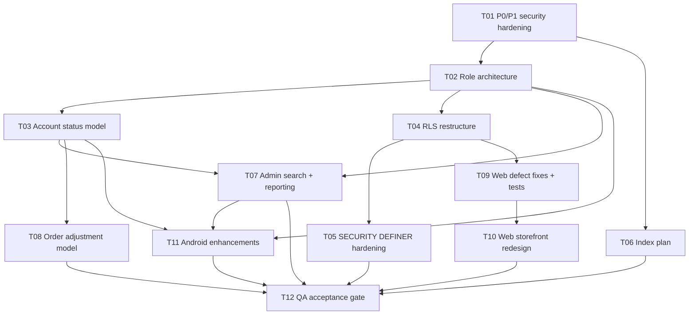

# System Design — Vedant Fruit & Vegetables Platform (REMEDIATION)

> **Author:** 高见远 (Bob), Architect · **Date:** 2026-10-16 · **Team:** `software-vedant-platform`
> **Project:** Supabase `hyibaljxicojfoxbihdn` (Postgres 17.11) + Next.js 16 customer PWA + Kotlin/Compose Android admin/delivery app
> **Nature of this workstream:** this is **not greenfield**. It is a **remediation + extension** of a live platform. The design below fixes live security/performance defects, introduces the missing role & account-status architecture, and decomposes the remaining app work.
>
> **Evidence basis.** Every statement about current state is either (a) read from a file in `docs/` (named inline) or (b) the result of a **live read-only query I ran against the project on 2026-10-16**. Items that are design choices or cannot be observed are marked **[ASSUMPTION]**. The live database wins over any document.

---

## 0. Verified live state (ground truth, queried 2026-10-16)

| Item | Live value (verified) |
|---|---|
| Relations in `public` | 18 tables + 1 view `product_catalog` (`reloptions = security_invoker=true` — already hardened) |
| RLS | **enabled on all 18 tables**; `rls_forced=false` everywhere |
| `private` schema | exists: `private.admin_users` (2 rows), `private.generate_delivery_slots`, `private.is_admin`, `private.order_transition_allowed` |
| Enums | `order_status(PENDING,CONFIRMED,PROCESSING,READY_FOR_DELIVERY,OUT_FOR_DELIVERY,DELIVERED,CANCELLED)`, `complaint_status(OPEN,IN_PROGRESS,RESOLVED,CLOSED)`, `complaint_type(WRONG_ITEM,DAMAGED,MISSING_ITEM,LATE_DELIVERY,QUALITY,OTHER)`, `user_role(customer,admin)`, `outbox_audience(customer,admin)` |
| Functions | 21 in `public` + 3 in `private` (full bodies read; see §5) |
| Triggers | 15 user triggers (2 notify + 1 history + 1 pincode + 11 `set_updated_at`) |
| Storage buckets | `product-images` (public), `complaint-images` (private, 5 MiB, jpeg/png/webp) — **both exist** |
| Row counts | profiles 4 · orders 1 · order_items 2 · products 32 · categories 10 · product_weights 24 · offers 10 · delivery_slots 57 · cart_items 4 · notification_outbox 7 · admin_users 2 · **events 0** · addresses 0 · complaints 0 |
| `events` policy | `events_insert_any` `{anon,authenticated}` INSERT `WITH CHECK (true)` — **STILL LIVE (P0)** |
| `storage.objects` policy | `product_images_public_read` `{anon,authenticated}` SELECT `bucket_id='product-images'` — **STILL LIVE (P1)** |
| Live Advisors (today) | **26 security** = 18 `authenticated_security_definer_function_executable` + 7 `anon_security_definer_function_executable` + 1 `auth_leaked_password_protection`; **66 performance** = 26 `multiple_permissive_policies` + 18 `auth_rls_initplan` + 17 `unused_index` + 5 `unindexed_foreign_keys` |
| Table grants | every `public` table grants ALL to `anon`/`authenticated`/`service_role` (Supabase default) — **RLS is the only gate**; `events` is therefore world-writable via its always-true policy |
| Migration on disk | `supabase/migrations/20261016_001_p0_security_hardening.sql` — drafted, **NEVER APPLIED** |

**Reconciliation of the register's 98 findings vs live (98 = 92 + 6).** The register (`docs/SUPABASE_FINDING_REGISTER.md`) lists 98; the live Advisor API returns 92. The 6 not returned by the API are **still real in the DB**: 4 `unused_index` entries (`addresses_user_idx`, `order_items_order_idx`, `cart_items_user_idx`, `order_status_history_order_idx`) are now flagged *used* by the planner, and the 2 lints `rls_policy_always_true` + `public_bucket_allows_listing` are confirmed present by direct `pg_policies` reads even though the current API output groups them differently. **The register's 98 remains the authoritative finding set; §1 reconciles each.**

---

# PART A — SYSTEM DESIGN

## 1. Finding classification

Severity legend: **P0** stop-ship security · **P1** security/perf that must ship with P0 · **P2** performance · **P3** housekeeping.
Every row: ID · object · severity · original problem · root cause · fix strategy · verification.

### 1.1 `anon_security_definer_function_executable` — 7 findings — **P0**

Root cause (all 7): these functions were created with default `EXECUTE` to `PUBLIC`, so `anon` can invoke them over `POST /rest/v1/rpc/<fn>`. Six are **trigger functions** (verified in `pg_trigger`) that need no `EXECUTE` grant at all; `check_username_available` is a genuine callable but is safe only after `search_path` pinning.

| ID | Object | Sev | Problem | Root cause | Fix strategy | Verification |
|---|---|---|---|---|---|---|
| P0-ANON-01 | `check_username_available(text)` | P0 | anon can enumerate usernames | `PUBLIC` EXECUTE + `search_path=public,pg_temp` (mutable) | **Keep callable by anon** (signup needs it) but pin `SET search_path=''` + fully-qualified names; rate-limit at the edge | `has_function_privilege('anon', …, 'EXECUTE')=true` **and** `proconfig` contains `search_path=""`; probe returns 200 only for a real username |
| P0-ANON-02 | `handle_new_user()` | P0 | RPC-reachable trigger fn | `PUBLIC` EXECUTE | Trigger fn → **revoke** EXECUTE from `public,anon,authenticated` | `proacl` no longer grants anon; trigger still fires on signup |
| P0-ANON-03 | `notify_complaint_event()` | P0 | RPC-reachable trigger fn | `PUBLIC` EXECUTE | Trigger fn → **revoke** | same |
| P0-ANON-04 | `notify_order_event()` | P0 | RPC-reachable trigger fn | `PUBLIC` EXECUTE | Trigger fn → **revoke** | same |
| P0-ANON-05 | `record_order_status_history()` | P0 | RPC-reachable trigger fn | `PUBLIC` EXECUTE | Trigger fn → **revoke** | same |
| P0-ANON-06 | `sync_address_pincode()` | P0 | RPC-reachable trigger fn | `PUBLIC` EXECUTE | Trigger fn → **revoke** | same |
| P0-ANON-07 | `sync_profile_phone()` | P0 | RPC-reachable trigger fn | `PUBLIC` EXECUTE | Trigger fn → **revoke** | same |

### 1.2 `rls_policy_always_true` — 1 finding — **P0**

| ID | Object | Sev | Problem | Root cause | Fix strategy | Verification |
|---|---|---|---|---|---|---|
| P0-RLS-01 | `public.events :: events_insert_any` | P0 | unrestricted INSERT for anon+authenticated | policy authored with `WITH CHECK (true)`; no user column, no writer in either client | **Drop the policy** (§6). `events` is empty with no writer; if telemetry is later wanted, add a bounded server-side RPC, never a `true` policy | `pg_policies` returns 0 rows for `events` INSERT; anon `POST /rest/v1/events` → `401/42501` |

### 1.3 `authenticated_security_definer_function_executable` — 18 findings — **P1**

Root cause: same `PUBLIC` EXECUTE default (or explicit `authenticated` grant) + several with mutable `search_path`. **This is NOT a call to blanket-convert to INVOKER** — the admin RPCs *must* be DEFINER. The correct fix is per-function: pin `search_path`, keep DEFINER, add/verify an internal authorization gate, revoke `EXECUTE` from the roles that must not call it. Full per-function analysis in **§5**.

| ID | Object | Sev | Intended caller | Fix (summary) |
|---|---|---|---|---|
| P1-AUTH-01 | `admin_grant_admin(text,text)` | P1 | OWNER only | pin `search_path=''`; gate → `private.can_manage_roster()`; **revoke** from `authenticated`, grant to `authenticated` **only via the gate** (see §2) |
| P1-AUTH-02 | `admin_list_admins()` | P1 | OWNER/ADMIN | pin; gate → `private.can_manage_users()` |
| P1-AUTH-03 | `admin_reject_order_item(uuid,text)` | P1 | staff (orders) | pin; gate → `private.can_manage_orders()` |
| P1-AUTH-04 | `admin_restore_order_item(uuid)` | P1 | staff (orders) | pin; gate → `private.can_manage_orders()` |
| P1-AUTH-05 | `admin_revoke_admin(uuid)` | P1 | OWNER only | pin; gate → `private.can_manage_roster()` |
| P1-AUTH-06 | `admin_slot_load(date,int)` | P1 | staff | pin; gate → `private.is_staff()` |
| P1-AUTH-07 | `admin_update_order_status(uuid,order_status,text)` | P1 | staff (orders) | pin; gate → `private.can_manage_orders()` |
| P1-AUTH-08 | `check_username_available(text)` | P1 | anon+auth | (see P0-ANON-01) |
| P1-AUTH-09 | `ensure_delivery_slots(int)` | P1 | staff | pin; gate → `private.can_manage_catalogue()` |
| P1-AUTH-10 | `handle_new_user()` | P1 | trigger | revoke EXECUTE |
| P1-AUTH-11 | `is_admin()` | P1 | RLS policies | keep EXECUTE for `authenticated` (policies evaluate as caller); pin `search_path=''` (already `""`) |
| P1-AUTH-12 | `notify_complaint_event()` | P1 | trigger | revoke |
| P1-AUTH-13 | `notify_order_event()` | P1 | trigger | revoke |
| P1-AUTH-14 | `place_order(text,uuid,uuid)` | P1 | authenticated customer | **keep** (the checkout path); pin; ensure `auth.uid()` + account-status + cart-empty checks |
| P1-AUTH-15 | `place_order_app(text,uuid,uuid)` | P1 | authenticated customer | **keep**; pin; add account-status check |
| P1-AUTH-16 | `record_order_status_history()` | P1 | trigger | revoke |
| P1-AUTH-17 | `sync_address_pincode()` | P1 | trigger | revoke |
| P1-AUTH-18 | `sync_profile_phone()` | P1 | trigger | revoke |

### 1.4 `auth_leaked_password_protection` — 1 finding — **P1**

| ID | Object | Sev | Problem | Root cause | Fix | Verification |
|---|---|---|---|---|---|---|
| P1-PW-01 | Supabase Auth config | P1 | compromised passwords accepted | HaveIBeenPwned check disabled in project Auth settings | Enable "Leaked password protection" in Dashboard → Auth (or Management API `PATCH /config/auth`). **Not a SQL change.** | Auth advisor returns 0 `auth_leaked_password_protection` |

### 1.5 `public_bucket_allows_listing` — 1 finding — **P1**

| ID | Object | Sev | Problem | Root cause | Fix | Verification |
|---|---|---|---|---|---|---|
| P1-BUCKET-01 | `storage.objects :: product_images_public_read` | P1 | anon can list every object in a public bucket | broad `SELECT` policy on a **public** bucket (unnecessary — public object URLs bypass RLS) | **Drop the policy** (§7). Keep `product_images_admin_*` (insert/update/delete). Object URLs keep working. | URL 200; anon `GET /storage/v1/object/list/product-images` → `[]`/denied; anon PUT → denied |

### 1.6 `unindexed_foreign_keys` — 5 findings — **P1**

| ID | Object | Sev | Fix | Verification |
|---|---|---|---|---|
| P1-FK-01 | `cart_items.cart_items_product_id_fkey` | P1 | add `cart_items_product_idx(product_id)` | `pg_indexes` shows the index |
| P1-FK-02 | `cart_items.cart_items_weight_id_fkey` | P1 | add `cart_items_weight_idx(weight_id)` | same |
| P1-FK-03 | `complaint_messages.complaint_messages_author_id_fkey` | P1 | add `complaint_messages_author_idx(author_id)` | same |
| P1-FK-04 | `orders.orders_address_id_fkey` | P1 | add `orders_address_idx(address_id)` | same |
| P1-FK-05 | `orders.orders_delivery_slot_id_fkey` | P1 | add `orders_delivery_slot_idx(delivery_slot_id)` | same |

### 1.7 `auth_rls_initplan` — 18 findings — **P2**

Root cause: each policy calls `auth.uid()` (a `STABLE` function reading `current_setting`) **per row** instead of once per query. Fix = wrap as `(select auth.uid())`. Semantically identical (`auth.uid()` is immutable within a statement). Per-policy rewrite in **§4.1**.

| ID | Policy | ID | Policy |
|---|---|---|---|
| P2-INIT-01 | `profiles_insert_own` | P2-INIT-10 | `orders_select_own` |
| P2-INIT-02 | `profiles_select_own` | P2-INIT-11 | `orders_update_own` |
| P2-INIT-03 | `profiles_update_own` | P2-INIT-12 | `order_status_history_owner` |
| P2-INIT-04 | `complaints_owner_all` | P2-INIT-13 | `order_items_insert_via_order` |
| P2-INIT-05 | `complaint_attachments_owner_all` | P2-INIT-14 | `order_items_owner_all` |
| P2-INIT-06 | `notification_outbox_select_own` | P2-INIT-15 | `order_items_select_via_order` |
| P2-INIT-07 | `addresses_owner_all` | P2-INIT-16 | `complaint_messages_owner` |
| P2-INIT-08 | `cart_items_owner_all` | P2-INIT-17 | `notifications_owner_select` |
| P2-INIT-09 | `orders_insert_own` | P2-INIT-18 | `notifications_owner_update` |

### 1.8 `multiple_permissive_policies` — 26 findings — **P2**

Root cause: two PERMISSIVE policies cover the same `(role,cmd)`; Postgres ORs them but evaluates both. Fix = **merge into one policy** (catalogue/owner pairs) or **split the admin `ALL` policy** so it no longer overlaps SELECT (see §4.2). Per-table rewrite in **§4.2**.

| ID | Table · cmd | Policies | ID | Table · cmd | Policies |
|---|---|---|---|---|---|
| P2-MULTI-01 | categories · SELECT | `categories_admin_write,categories_read_public` | P2-MULTI-14 | notification_outbox · SELECT | `notification_outbox_admin_read,notification_outbox_select_own` |
| P2-MULTI-02 | complaint_attachments · DELETE | `…admin_all,…owner_all` | P2-MULTI-15 | offers · SELECT | `offers_admin_write,offers_read_public` |
| P2-MULTI-03 | complaint_attachments · INSERT | same | P2-MULTI-16 | order_items · INSERT | `order_items_insert_via_order,order_items_owner_all` |
| P2-MULTI-04 | complaint_attachments · SELECT | same | P2-MULTI-17 | order_items · SELECT | `order_items_admin_select,order_items_owner_all,order_items_select_via_order` |
| P2-MULTI-05 | complaint_attachments · UPDATE | same | P2-MULTI-18 | order_status_history · SELECT | `order_status_history_admin_select,order_status_history_owner` |
| P2-MULTI-06 | complaint_messages · DELETE | `…admin_all,…owner` | P2-MULTI-19 | orders · SELECT | `orders_admin_select,orders_select_own` |
| P2-MULTI-07 | complaint_messages · INSERT | same | P2-MULTI-20 | product_weights · SELECT | `product_weights_admin_write,product_weights_read_public` |
| P2-MULTI-08 | complaint_messages · SELECT | same | P2-MULTI-21 | products · SELECT | `products_admin_write,products_read_public` |
| P2-MULTI-09 | complaint_messages · UPDATE | same | P2-MULTI-22 | profiles · INSERT | `profiles_admin_all,profiles_insert_own` |
| P2-MULTI-10 | complaints · DELETE | `complaints_admin_all,complaints_owner_all` | P2-MULTI-23 | profiles · SELECT | `profiles_admin_all,profiles_select_own` |
| P2-MULTI-11 | complaints · INSERT | same | P2-MULTI-24 | profiles · UPDATE | `profiles_admin_all,profiles_update_own` |
| P2-MULTI-12 | complaints · SELECT | same | P2-MULTI-25 | store_settings · SELECT | `store_settings_admin_write,store_settings_read_public` |
| P2-MULTI-13 | delivery_slots · SELECT | `delivery_slots_admin_write,delivery_slots_read_public` | P2-MULTI-26 | complaints · UPDATE | `complaints_admin_all,complaints_owner_all` |

### 1.9 `unused_index` — 21 (register) / 17 (live) — **P3**

Live no longer flags 4 (`addresses_user_idx`, `order_items_order_idx`, `cart_items_user_idx`, `order_status_history_order_idx`) — they are now planner-used. Verdicts for all 17 live + the 4 reconciled are in **§8**.

---

## 2. Target role architecture

### 2.1 Where roles live (trusted DB only)

Roles are stored **only** in Postgres. Clients may *read* a role to shape UI, but **never** to authorize — authorization is always re-evaluated server-side by RLS policies and `SECURITY DEFINER` RPCs.

| Source | Status | Use |
|---|---|---|
| `private.user_roles(user_id, role staff_role, …)` | **NEW — authoritative** | the single source of truth for staff role |
| `public.profiles.role user_role(customer,admin)` | kept | coarse back-compat flag only; kept in step by triggers on `private.user_roles` |
| `private.admin_users(user_id, note, created_at)` | kept (2 rows) | legacy roster; **migrated into** `private.user_roles` as role `ADMIN` (or `OWNER` for the founder) |
| `raw_user_meta_data` | **FORBIDDEN** | user-editable at signup — never a role source |
| localStorage / Zustand / Compose state | **FORBIDDEN** | client-authoritative — never a role source |

> **[ASSUMPTION]** The two existing `private.admin_users` rows are the store owner's account(s). Migration seeds one as `OWNER` (the earliest `created_at`) and the other as `ADMIN`; the owner confirms/reassigns via `owner_grant_role`.

### 2.2 Enum + tables (DDL)

```sql
-- 1) Granular staff role
create type public.staff_role as enum ('OWNER','ADMIN','MANAGER','DELIVERY','SUPPORT');

-- 2) Authoritative role table (private schema — not reachable from client SDKs)
create table private.user_roles (
  user_id     uuid primary key references auth.users(id) on delete cascade,
  role        public.staff_role not null,
  granted_by  uuid references auth.users(id),
  granted_at  timestamptz not null default now(),
  note        text,
  is_active   boolean not null default true
);
create index user_roles_role_idx on private.user_roles(role) where is_active;

-- 3) One-time migration from the legacy roster + profiles.role
insert into private.user_roles (user_id, role, granted_at, note)
select a.user_id,
       case when a.user_id = (select user_id from private.admin_users order by created_at limit 1)
            then 'OWNER'::public.staff_role else 'ADMIN'::public.staff_role end,
       a.created_at, a.note
from private.admin_users a
on conflict (user_id) do nothing;
```

### 2.3 Capability helper functions (all `SECURITY DEFINER`, `SET search_path=''`, `STABLE`)

These are the **only** authorization primitives; RLS policies and RPCs call them. `EXECUTE` is granted to `authenticated` (policies evaluate as the caller) but they return `boolean`/`staff_role` only — no data leak.

```sql
create or replace function private.role_of(p_user uuid default null)
returns public.staff_role
language sql stable security definer set search_path = '' as $$
  select r.role from private.user_roles r
  where r.user_id = coalesce(p_user, (select auth.uid())) and r.is_active
  limit 1;
$$;

create or replace function private.has_role(p_roles public.staff_role[])
returns boolean
language sql stable security definer set search_path = '' as $$
  select exists (
    select 1 from private.user_roles r
    where r.user_id = (select auth.uid()) and r.is_active and r.role = any(p_roles)
  );
$$;

-- named capabilities (readable call-sites; single place to change policy)
create or replace function private.is_owner()             returns boolean language sql stable security definer set search_path='' as $$ select private.has_role(array['OWNER']::public.staff_role[]); $$;
create or replace function private.is_staff()             returns boolean language sql stable security definer set search_path='' as $$ select private.has_role(array['OWNER','ADMIN','MANAGER','DELIVERY','SUPPORT']::public.staff_role[]); $$;
create or replace function private.can_manage_roster()    returns boolean language sql stable security definer set search_path='' as $$ select private.has_role(array['OWNER']::public.staff_role[]); $$;
create or replace function private.can_manage_users()     returns boolean language sql stable security definer set search_path='' as $$ select private.has_role(array['OWNER','ADMIN']::public.staff_role[]); $$;
create or replace function private.can_manage_catalogue() returns boolean language sql stable security definer set search_path='' as $$ select private.has_role(array['OWNER','ADMIN','MANAGER']::public.staff_role[]); $$;
create or replace function private.can_manage_orders()    returns boolean language sql stable security definer set search_path='' as $$ select private.has_role(array['OWNER','ADMIN','MANAGER','DELIVERY']::public.staff_role[]); $$;
create or replace function private.can_view_orders()      returns boolean language sql stable security definer set search_path='' as $$ select private.is_staff(); $$;
create or replace function private.can_manage_complaints()returns boolean language sql stable security definer set search_path='' as $$ select private.has_role(array['OWNER','ADMIN','MANAGER','SUPPORT']::public.staff_role[]); $$;
create or replace function private.can_manage_store()     returns boolean language sql stable security definer set search_path='' as $$ select private.has_role(array['OWNER','ADMIN']::public.staff_role[]); $$;

-- keep private.is_admin() working (existing RLS + admin RPCs reference it):
create or replace function private.is_admin()
returns boolean language sql stable security definer set search_path = '' as $$
  select private.is_staff();
$$;
```

> `private.is_admin()` is retained as a **compatibility shim** = `is_staff()`. After the §4 RLS restructure, no policy calls the coarse `public.is_admin()` for **writes**; write policies call the specific `can_manage_*` capability. `public.is_admin()` stays only as a deprecated alias for any lingering reader.

### 2.4 Permission matrix

`✓` = allowed · `—` = denied. CUSTOMER = any authenticated non-staff user.

| Capability | OWNER | ADMIN | MANAGER | DELIVERY | SUPPORT | CUSTOMER | ANON |
|---|:-:|:-:|:-:|:-:|:-:|:-:|:-:|
| Read public catalogue (`is_active`) | ✓ | ✓ | ✓ | ✓ | ✓ | ✓ | ✓ |
| Read all orders / items / history | ✓ | ✓ | ✓ | ✓ | ✓ | own only | — |
| Change order status (`admin_update_order_status`) | ✓ | ✓ | ✓ | ✓ | — | — | — |
| Reject / restore order item | ✓ | ✓ | ✓ | ✓ | — | — | — |
| Place an order (`place_order`) | ✓ | ✓ | ✓ | ✓ | ✓ | ✓ (ACTIVE) | — |
| Read all complaints + threads | ✓ | ✓ | ✓ | — | ✓ | own only | — |
| Reply / resolve complaints | ✓ | ✓ | ✓ | — | ✓ | own reply | — |
| CRUD catalogue (products/weights/offers/categories) | ✓ | ✓ | ✓ | — | — | — | — |
| Upload product images | ✓ | ✓ | ✓ | — | — | — | — |
| Manage delivery slots (`ensure_delivery_slots`, upsert) | ✓ | ✓ | ✓ | — | — | — | — |
| View slot load (`admin_slot_load`) | ✓ | ✓ | ✓ | ✓ | — | — | — |
| Edit store settings | ✓ | ✓ | — | — | — | — | — |
| View user list / search users | ✓ | ✓ | ✓ | — | ✓ | — | — |
| Set account status SUSPENDED / BLOCKED | ✓ | ✓ | — | — | — | — | — |
| Set account status DELETED (soft) | ✓ | — | — | — | — | — | — |
| Grant / revoke ADMIN / MANAGER / DELIVERY / SUPPORT | **✓ only** | — | — | — | — | — | — |
| Grant / revoke OWNER | **✓ only** (last-OWNER guard) | — | — | — | — | — | — |
| Read audit log | ✓ | ✓ | — | — | — | — | — |
| Upload complaint attachment | ✓ | ✓ | ✓ | — | ✓ | own | — |

### 2.5 OWNER vs ADMIN — why only OWNER may grant/revoke ADMIN

* **Single accountable principal.** OWNER is the business principal; ADMIN is a delegate. If ADMIN could grant ADMIN, the principal loses control of the roster (privilege-escalation loop) and can never fully revoke access.
* **Escalation containment.** `owner_grant_role` / `owner_revoke_role` gate on `private.can_manage_roster()` = `is_owner()`. An ADMIN calling them raises `42501`. Combined with the existing **last-admin guard** (keep it, extended to **last-OWNER**), the system can never be locked out or self-escalated.
* **Enforcement point.** The gate is inside the `SECURITY DEFINER` function (server-side), not in the UI. UI hides the control; the function refuses regardless.

```sql
-- replaces admin_grant_admin / admin_revoke_admin semantics
create or replace function public.owner_grant_role(
  p_email text, p_role public.staff_role, p_note text default null
) returns uuid
language plpgsql security definer set search_path = '' as $$
declare v_uid uuid;
begin
  if not private.can_manage_roster() then
    raise exception 'owner authorization required' using errcode = '42501';
  end if;
  if p_role is null then
    raise exception 'role is required' using errcode = '22023';
  end if;
  select u.id into v_uid from auth.users u where lower(u.email) = lower(trim(p_email)) limit 1;
  if v_uid is null then
    raise exception 'no account exists for that email' using errcode = '22023';
  end if;
  insert into private.user_roles (user_id, role, granted_by, note)
  values (v_uid, p_role, (select auth.uid()), p_note)
  on conflict (user_id) do update
    set role = excluded.role, granted_by = excluded.granted_by,
        granted_at = now(), note = excluded.note, is_active = true;
  update public.profiles set role = (case when p_role = 'OWNER' or p_role = 'ADMIN'
                                     then 'admin' else 'customer' end)::public.user_role
  where id = v_uid;
  insert into public.audit_logs (actor_id, actor_role, action, entity_type, entity_id, after)
  values ((select auth.uid()), private.role_of(), 'grant_role', 'user', v_uid::text,
          jsonb_build_object('role', p_role, 'note', p_note));
  return v_uid;
end $$;

create or replace function public.owner_revoke_role(p_user_id uuid)
returns void
language plpgsql security definer set search_path = '' as $$
begin
  if not private.can_manage_roster() then
    raise exception 'owner authorization required' using errcode = '42501';
  end if;
  if (select count(*) from private.user_roles where role = 'OWNER' and is_active) <= 1
     and (select role from private.user_roles where user_id = p_user_id) = 'OWNER' then
    raise exception 'cannot revoke the last remaining owner' using errcode = '22023';
  end if;
  delete from private.user_roles where user_id = p_user_id;
  update public.profiles set role = 'customer'::public.user_role where id = p_user_id;
  insert into public.audit_logs (actor_id, actor_role, action, entity_type, entity_id)
  values ((select auth.uid()), private.role_of(), 'revoke_role', 'user', p_user_id::text);
end $$;
```

---

## 3. Account status model

### 3.1 Enum + profile columns (DDL)

```sql
create type public.account_status as enum ('ACTIVE','SUSPENDED','BLOCKED','DELETED');

alter table public.profiles
  add column account_status      public.account_status not null default 'ACTIVE',
  add column status_reason       text,
  add column status_updated_at   timestamptz,
  add column status_updated_by   uuid references auth.users(id),
  add column status_expires_at   timestamptz;   -- nullable; auto-revert when reached
create index profiles_account_status_idx on public.profiles(account_status);
```

### 3.2 History + audit tables (DDL)

```sql
create table public.account_status_history (
  id            uuid primary key default gen_random_uuid(),
  user_id       uuid not null references auth.users(id) on delete cascade,
  old_status    public.account_status,
  new_status    public.account_status not null,
  reason        text not null,
  actor_id      uuid references auth.users(id),
  actor_role    public.staff_role,
  expires_at    timestamptz,
  created_at    timestamptz not null default now()
);
create index account_status_history_user_idx on public.account_status_history(user_id, created_at desc);

create table public.audit_logs (
  id           bigint generated always as identity primary key,
  actor_id     uuid references auth.users(id),
  actor_role   public.staff_role,
  action       text not null,
  entity_type  text not null,
  entity_id    text,
  before       jsonb,
  after        jsonb,
  reason       text,
  created_at   timestamptz not null default now()
);
create index audit_logs_entity_idx  on public.audit_logs(entity_type, entity_id, created_at desc);
create index audit_logs_actor_idx   on public.audit_logs(actor_id, created_at desc);
create index audit_logs_created_idx on public.audit_logs(created_at desc);
```

### 3.3 RLS for the new tables

```sql
alter table public.account_status_history enable row level security;
alter table public.audit_logs              enable row level security;

-- a user may read their own status history; staff who manage users may read all
create policy ash_select on public.account_status_history for select to authenticated
  using ( user_id = (select auth.uid()) or private.can_manage_users() );
-- no client INSERT/UPDATE/DELETE — rows are written only by the DEFINER RPC below

create policy audit_select on public.audit_logs for select to authenticated
  using ( private.can_manage_users() );
-- no client writes at all
```

### 3.4 Rules

| Status | Authenticate? | Read own data? | Place new orders? | Other writes |
|---|:-:|:-:|:-:|:-:|
| ACTIVE | ✓ | ✓ | ✓ | normal |
| SUSPENDED | ✓ | ✓ | **✗** | cart ok; no new order, no complaint |
| BLOCKED | ✓ | ✓ (history only) | **✗** | no writes |
| DELETED | **✗** (auth banned) | ✗ | ✗ | none |

* **Only appropriate roles may change status**: SUSPENDED/BLOCKED → `can_manage_users()` (OWNER/ADMIN); DELETED → OWNER only.
* **Every change records** reason + actor + timestamp + optional expiry → `account_status_history` row + `profiles.*` update + `audit_logs` row, in one transaction.
* **Expiry**: a `status_expires_at` in the past is treated as ACTIVE by the enforcement check (lazy revert), and a nightly job (pg_cron) may hard-revert.
* **Enforcement is server-side** in `place_order_app` (below) — a suspended user's checkout raises `42501` before any business logic.

```sql
-- one RPC to change status (server-authoritative)
create or replace function public.admin_set_account_status(
  p_user_id uuid, p_status public.account_status, p_reason text,
  p_expires_at timestamptz default null
) returns public.profiles
language plpgsql security definer set search_path = '' as $$
declare v_old public.account_status; v_row public.profiles;
begin
  if not private.can_manage_users() then
    raise exception 'not authorized' using errcode = '42501';
  end if;
  if p_status = 'DELETED' and not private.is_owner() then
    raise exception 'only the owner may delete an account' using errcode = '42501';
  end if;
  if nullif(trim(coalesce(p_reason,'')),'') is null then
    raise exception 'a reason is required' using errcode = '22023';
  end if;
  select account_status into v_old from public.profiles where id = p_user_id for update;
  if not found then raise exception 'user not found' using errcode = '22023'; end if;

  update public.profiles
     set account_status = p_status, status_reason = p_reason,
         status_updated_at = now(), status_updated_by = (select auth.uid()),
         status_expires_at = p_expires_at
   where id = p_user_id returning * into v_row;

  insert into public.account_status_history
    (user_id, old_status, new_status, reason, actor_id, actor_role, expires_at)
  values (p_user_id, v_old, p_status, p_reason, (select auth.uid()), private.role_of(), p_expires_at);

  insert into public.audit_logs (actor_id, actor_role, action, entity_type, entity_id, before, after, reason)
  values ((select auth.uid()), private.role_of(), 'set_account_status', 'user', p_user_id::text,
          jsonb_build_object('account_status', v_old), jsonb_build_object('account_status', p_status), p_reason);

  -- hard auth ban only for DELETED (needs elevated privilege → done here as DEFINER)
  if p_status = 'DELETED' then
    update auth.users set banned_until = 'infinity' where id = p_user_id;
  elsif p_status in ('ACTIVE','SUSPENDED') then
    update auth.users set banned_until = null where id = p_user_id and banned_until is not null;
  end if;

  return v_row;
end $$;
```

`place_order_app` gains, immediately after the `v_uid is null` check:

```sql
if exists (
  select 1 from public.profiles p
  where p.id = v_uid
    and ( p.account_status = 'BLOCKED'
       or p.account_status = 'DELETED'
       or (p.account_status = 'SUSPENDED'
           and (p.status_expires_at is null or p.status_expires_at > now())) )
) then
  raise exception 'account is not permitted to place orders' using errcode = '42501';
end if;
```

---

## 4. RLS restructure plan

### 4.1 `auth_rls_initplan` — 18 policies (mechanical, semantics-preserving)

Rule: replace every `auth.uid()` in a policy expression with `(select auth.uid())`. `auth.uid()` is `STABLE` and constant within a statement, so the two forms are **semantically equivalent**; the subquery form lets the planner evaluate it **once** (InitPlan) instead of once per row. Representative rewrites (all 18 follow the same transform):

```sql
-- P2-INIT-01/02/03 profiles
drop policy profiles_insert_own on public.profiles;
create policy profiles_insert_own on public.profiles for insert to authenticated
  with check ( (select auth.uid()) = id );

drop policy profiles_select_own on public.profiles;
create policy profiles_select_own on public.profiles for select to authenticated
  using ( (select auth.uid()) = id );

drop policy profiles_update_own on public.profiles;
create policy profiles_update_own on public.profiles for update to authenticated
  using ( (select auth.uid()) = id )
  with check ( (select auth.uid()) = id );

-- P2-INIT-07 addresses
drop policy addresses_owner_all on public.addresses;
create policy addresses_owner_all on public.addresses for all to authenticated
  using ( (select auth.uid()) = user_id ) with check ( (select auth.uid()) = user_id );

-- P2-INIT-08 cart_items
drop policy cart_items_owner_all on public.cart_items;
create policy cart_items_owner_all on public.cart_items for all to authenticated
  using ( (select auth.uid()) = user_id ) with check ( (select auth.uid()) = user_id );

-- P2-INIT-09/10/11 orders
drop policy orders_insert_own on public.orders;
create policy orders_insert_own on public.orders for insert to authenticated
  with check ( (select auth.uid()) = user_id );
drop policy orders_select_own on public.orders;
create policy orders_select_own on public.orders for select to authenticated
  using ( (select auth.uid()) = user_id );
drop policy orders_update_own on public.orders;
create policy orders_update_own on public.orders for update to authenticated
  using ( (select auth.uid()) = user_id ) with check ( (select auth.uid()) = user_id );

-- P2-INIT-04/05/06/12/13/14/15/16/17/18: same transform on
--   complaints_owner_all, complaint_attachments_owner_all,
--   notification_outbox_select_own, order_status_history_owner,
--   order_items_insert_via_order, order_items_owner_all,
--   order_items_select_via_order, complaint_messages_owner,
--   notifications_owner_select, notifications_owner_update
--   (each `auth.uid()` -> `(select auth.uid())`).
```

> **Note on `orders_update_own`.** After the order-adjustment model (§10) the customer should not mutate a placed order. Keep the policy but restrict it to the pre-placement window (`status='PENDING'` and only the `cancel` path) or drop it and route cancellation through an RPC. **[ASSUMPTION]** cancellation is customer-initiated via RPC; the raw UPDATE policy is narrowed to `status='PENDING'`.

> ### ⚠️ CORRECTION (T03, applied + verified live 2026-10-16) — do NOT copy the `profiles_update_own` block above
>
> The literal `with check ( (select auth.uid()) = id )` shown above **omits the role guard** the live policy carries — recreating it as written lets any customer set their own `role` to `admin` (privilege escalation). The original guard —
> `and role = (select p.role from public.profiles p where p.id = (select auth.uid()))` —
> **cannot** be combined with the `(select auth.uid())` InitPlan form in the `profiles_select` qual: Postgres raises
> `42P17 infinite recursion detected in policy for relation "profiles"` on **every** UPDATE. (Verified empirically: the bare `auth.uid()` form works; the `(select …)` form recurses.)
>
> **Required implementation (now live):** delegate the current-role lookup to a `SECURITY DEFINER` helper so the WITH CHECK contains no self-referential subquery:
> ```sql
> create or replace function private.current_profile_role()
> returns public.user_role language sql stable security definer set search_path = '' as $$
>   select p.role from public.profiles p where p.id = (select auth.uid());
> $$;
>
> create policy profiles_update_own on public.profiles for update to authenticated
>   using ( (select auth.uid()) = id )
>   with check ( (select auth.uid()) = id and role = private.current_profile_role() );
> ```
>
> **Five T03 deviations from this design (all applied + verified live):**
> 1. `orders_update_own` **dropped** (not narrowed) — no client updates `orders`; customer cancellation to become a `cancel_order` RPC (TODO).
> 2. `profiles_admin_all` **dropped** — admins lose blanket UPDATE on `profiles`; status changes go through `admin_set_account_status`.
> 3. Capability writes use the specific `can_manage_catalogue()` / `can_manage_store()` / `can_manage_complaints()` / `can_view_orders()` instead of the coarse `is_admin()` (least privilege per §2.4). Observed: DELIVERY/SUPPORT lose catalogue write, MANAGER loses store write, DELIVERY loses staff profile read.
> 4. `profiles` staff-read uses the new `private.can_view_users()` (OWNER/ADMIN/MANAGER/SUPPORT), **not** `can_manage_users()` — the latter is too narrow for MANAGER/SUPPORT per the §2.4 matrix.
> 5. Catalogue SELECT is **split** into `to anon` (public predicate only) and `to authenticated` (predicate OR capability): `anon` has no `USAGE` on the `private` schema and therefore cannot call `private.*` helpers.

### 4.2 `multiple_permissive_policies` — 26 (merge / split, preserving exact access)

Two techniques, chosen per table:

**(A) Catalogue "public-read + admin-write" pairs (P2-MULTI-01/13/15/20/21/25).** Replace the pair with one SELECT policy (`is_active OR can_manage_catalogue()`) **plus** separate INSERT/UPDATE/DELETE policies (the admin `ALL` policy previously covered SELECT, causing the overlap):

```sql
-- products (same shape for categories, product_weights, offers, delivery_slots)
drop policy products_read_public  on public.products;
drop policy products_admin_write  on public.products;
create policy products_select on public.products for select to anon, authenticated
  using ( is_active or private.can_manage_catalogue() );
create policy products_insert on public.products for insert to authenticated
  with check ( private.can_manage_catalogue() );
create policy products_update on public.products for update to authenticated
  using ( private.can_manage_catalogue() ) with check ( private.can_manage_catalogue() );
create policy products_delete on public.products for delete to authenticated
  using ( private.can_manage_catalogue() );

-- store_settings (public read of the singleton; OWNER/ADMIN write)
drop policy store_settings_read_public on public.store_settings;
drop policy store_settings_admin_write on public.store_settings;
create policy store_settings_select on public.store_settings for select to anon, authenticated using (true);
create policy store_settings_update on public.store_settings for update to authenticated
  using ( private.can_manage_store() ) with check ( private.can_manage_store() );

-- delivery_slots: read public; write can_manage_catalogue
```

**(B) "owner-own + admin-all" pairs (complaints, complaint_messages, complaint_attachments, profiles, order_items, orders, order_status_history, notification_outbox).** Split the admin `ALL` into cmd-specific policies and merge the SELECT into one OR-policy:

```sql
-- complaints  (P2-MULTI-10/11/12/26)
drop policy complaints_admin_all   on public.complaints;
drop policy complaints_owner_all   on public.complaints;
create policy complaints_select on public.complaints for select to authenticated
  using ( (select auth.uid()) = user_id or private.can_manage_complaints() );
create policy complaints_insert on public.complaints for insert to authenticated
  with check ( (select auth.uid()) = user_id );
create policy complaints_update on public.complaints for update to authenticated
  using ( (select auth.uid()) = user_id or private.can_manage_complaints() )
  with check ( (select auth.uid()) = user_id or private.can_manage_complaints() );
create policy complaints_delete on public.complaints for delete to authenticated
  using ( private.can_manage_complaints() );

-- complaint_messages / complaint_attachments: same, owner predicate via EXISTS(complaints.user_id=uid)
-- profiles (P2-MULTI-22/23/24)
drop policy profiles_admin_all on public.profiles;
-- profiles_insert_own / select_own / update_own already exist (rewritten in §4.1);
-- add staff read (no duplicate SELECT):
create policy profiles_staff_select on public.profiles for select to authenticated
  using ( private.can_manage_users() );

-- orders (P2-MULTI-19): merge admin_select into one SELECT
drop policy orders_admin_select on public.orders;
drop policy orders_select_own   on public.orders;
create policy orders_select on public.orders for select to authenticated
  using ( (select auth.uid()) = user_id or private.can_view_orders() );

-- order_items (P2-MULTI-16/17), order_status_history (P2-MULTI-18),
-- notification_outbox (P2-MULTI-14): single SELECT with OR of owner/staff predicate.
```

> **Access-rule preservation argument.** Every merged policy is the **logical OR** of the policies it replaces (permissive policies are OR-ed by Postgres), and every split policy keeps the same `cmd` scope as the original `ALL` covered. Therefore no role gains or loses a row. The QA task (§Part B, T12) proves it with the **anon/authenticated/staff/staff-of-other-role** probe matrix.

### 4.3 Data-tier separation (explicit)

| Tier | Tables | Read | Write |
|---|---|---|---|
| **PUBLIC READ** | `categories, products, product_weights, offers, delivery_slots, store_settings, product_catalog` | anon + authenticated where `is_active` (or `true` for settings) | `can_manage_catalogue()` / `can_manage_store()` |
| **CUSTOMER OWN DATA** | `addresses, cart_items, orders, order_items, order_status_history, complaints, complaint_messages, complaint_attachments, notifications, notification_outbox` | `(select auth.uid()) = <owner col>` | own rows only; orders via RPC |
| **STAFF DATA** | `orders, order_items, order_status_history, complaints, complaint_messages, complaint_attachments, delivery_slots(load), notification_outbox(admin)` | `can_view_orders()` / `can_manage_complaints()` / `is_staff()` | `can_manage_orders()` / `can_manage_complaints()` |
| **ADMIN DATA** | `profiles(all), account_status_history(all), audit_logs` | `can_manage_users()` | RPC only |
| **OWNER DATA** | `private.user_roles, private.admin_users` | `is_owner()` (via RPC `admin_list_admins`) | `owner_grant_role` / `owner_revoke_role` only |
| **SYSTEM DATA** | `notification_outbox(writes), order_status_history(writes), audit_logs(writes), account_status_history(writes)` | — | written by **triggers / DEFINER RPCs** only; no client INSERT/UPDATE/DELETE |

**No blanket `authenticated = true`.** Every policy names a specific predicate.

---

## 5. SECURITY DEFINER hardening

Principle: **DEFINER is a privilege, not a defect.** Each function below keeps DEFINER where it genuinely needs elevated rights, gains a pinned `search_path`, an internal authorization gate, and input validation; trigger-only and private helpers lose their `EXECUTE` grants. Verified facts: 6 of the anon-flagged functions are trigger functions (`pg_trigger`), `private.*` functions are `search_path=""` already, `public.is_admin()` is `search_path=""` already.

Legend — **Caller**: intended invoker · **Trigger?**: is it a trigger fn · **search_path**: target setting · **EXECUTE**: grants to keep · **Authz**: check to add/keep · **Escalation risk**.

| Function | DEFINER? why | Caller | Trigger? | search_path | EXECUTE keep | Authz | Validation | Escalation risk |
|---|---|---|---|---|---|---|---|---|
| `check_username_available(text)` | yes — reads `profiles` which anon cannot select | anon + auth | no | `SET ''` + `public.profiles` FQN | anon, authenticated | none (public info by design) | trim, length 3..24 | Low (username enumeration is inherent; rate-limit at edge) |
| `handle_new_user()` | yes — inserts into `profiles` during signup | auth trigger | **yes** | `SET ''` | **none** | n/a (trigger) | coalesce meta | was RPC-callable → revoke removes it |
| `notify_complaint_event()` | yes — writes `notification_outbox` | complaints trigger | **yes** | `SET ''` | **none** | n/a | left(desc,120) | was RPC-callable → revoke |
| `notify_order_event()` | yes — writes `notification_outbox` | orders trigger | **yes** | `SET ''` | **none** | n/a | — | was RPC-callable → revoke |
| `record_order_status_history()` | yes — writes history regardless of caller RLS | orders trigger | **yes** | `SET ''` | **none** | n/a | — | was RPC-callable → revoke |
| `sync_address_pincode()` | yes — normalises address fields | addresses trigger | **yes** | `SET ''` | **none** | n/a | regex pincode | was RPC-callable → revoke |
| `sync_profile_phone()` | yes — updates `profiles` from `auth.users` | auth trigger | **yes** | `SET ''` | **none** | n/a | — | was RPC-callable → revoke |
| `is_admin()` (public) | yes — must read `private.user_roles` (RLS-free) while evaluated as caller | RLS policies | no | `SET ''` (already) | authenticated | delegates to `private.is_admin()` | — | read-only boolean; safe |
| `private.is_admin()` / `role_of` / `has_role` / `can_*` | yes — read `private.user_roles` | public wrappers + policies | no | `SET ''` (already) | authenticated (via public wrapper) | — | — | boolean only |
| `private.generate_delivery_slots(int)` | yes — bulk-inserts slots | only `ensure_delivery_slots` | no | `SET ''` (already) | **none** | n/a (internal) | clamp days 1..60 | revoke PUBLIC EXECUTE |
| `private.order_transition_allowed(order_status,order_status)` | **INVOKER** already | only `admin_update_order_status` | no | `SET ''` | **none** | n/a | — | pure function; revoke PUBLIC EXECUTE |
| `ensure_delivery_slots(int)` | yes — calls private generator | staff | no | `SET ''` | authenticated | `can_manage_catalogue()` | clamp days | gate prevents slot spam |
| `place_order(text,uuid,uuid)` (app sig) | yes — transactional order write | authenticated customer | no | `SET ''` | authenticated | `auth.uid()` non-null (in `place_order_app`) | request_id 8..128 | **only customer order path** |
| `place_order_app(text,uuid,uuid)` | yes — builds items from `cart_items` | authenticated customer | no | `SET ''` | authenticated | `auth.uid()` + **account status** + cart non-empty | request_id length | add account-status gate (§3.4) |
| `place_order(uuid,date,uuid,jsonb)` (engine) | yes — inserts order/items, decrements stock | `place_order_app` | no | `SET ''` | **service_role only** (no authenticated) | validates `auth.uid()`, address ownership, slot, stock | qty 1..50, min order, date window | keep; not directly customer-callable |
| `admin_update_order_status(uuid,order_status,text)` | yes — writes orders + triggers | staff | no | `SET ''` | authenticated | `can_manage_orders()` | transition legality, reason ≤500 | gate is the whole point |
| `admin_reject_order_item(uuid,text)` | yes — writes items/orders | staff | no | `SET ''` | authenticated | `can_manage_orders()` | reason required ≤500 | money recomputed server-side |
| `admin_restore_order_item(uuid)` | yes | staff | no | `SET ''` | authenticated | `can_manage_orders()` | item must be rejected | same |
| `admin_slot_load(date,int)` | yes — counts orders | staff | no | `SET ''` | authenticated | `is_staff()` | clamp days | read-only |
| `admin_list_admins()` | yes — reads `private.admin_users` + `profiles` | OWNER/ADMIN | no | `SET ''` | authenticated | `can_manage_users()` | — | roster read |
| `admin_grant_admin` / `admin_revoke_admin` | yes — writes roster | OWNER | no | `SET ''` | **replace with `owner_grant_role`/`owner_revoke_role`** gated on `can_manage_roster()` | last-OWNER guard | email format, role enum | **highest risk — escalation; gate + revoke legacy** |
| `gen_order_number()` | **INVOKER** | `place_order` | no | `SET ''` | **revoke PUBLIC** (keep authenticated/service_role) | — | — | PUBLIC EXECUTE is unnecessary (supplementary finding) |
| `set_updated_at()` | **INVOKER** | triggers | **yes** | `SET ''` | **none** | n/a | — | PUBLIC EXECUTE (supplementary finding) |

**Supplementary findings (not in the register, found by `proacl` read):** `gen_order_number()` and `set_updated_at()` carry `EXECUTE` to `PUBLIC`; both are INVOKER so impact is low, but the grant is removed as hygiene. `gen_order_number` also currently runs with mutable `search_path=public,pg_temp` — pin to `''`.

**Order of application:** revoke grants **first** (closes the RPC surface immediately), then redefine bodies with `SET search_path=''` + FQN + gates. All inside one migration, `begin; … commit;`.

---

## 6. `events` decision

**Verified:** `events` has **0 rows**, **no writer in either client** (`grep` over `src/` and `admin-android/app/src` finds no `events` insert), no `user_id` column (so a row cannot be attributed, bounded, or audited), and the policy `events_insert_any` is `WITH CHECK (true)` for `{anon,authenticated}` — i.e. the table is world-writable with full table grants. The `docs/ACTION_PLAN_2026-10-11.md` §3.2 confirms instrumentation was never wired.

**Verdict: remove the policy now.** A `WITH CHECK (true)` INSERT cannot be "weakened" into something safe because there is nothing to scope on. The table stays dormant (empty, RLS on, no policy → all inserts denied). If telemetry is later wanted, it must arrive through a **bounded server-side path**, never a client `true` policy.

```sql
-- P0: close the hole
drop policy if exists events_insert_any on public.events;
```

**Optional future telemetry (only if the owner asks):** a rate-limited, validated DEFINER RPC — no direct table writes, no PII:

```sql
-- [FUTURE — do NOT apply now]
create table private.event_rate (session_hash text primary key, window_start timestamptz, n int);
create or replace function public.record_event(
  p_session_hash text, p_event text, p_path text default null, p_meta jsonb default '{}'::jsonb
) returns void language plpgsql security definer set search_path = '' as $$
begin
  if p_event not in ('page_view','search','add_to_cart','place_order') then
    raise exception 'unknown event' using errcode = '22023';
  end if;
  if char_length(p_session_hash) < 8 or char_length(p_session_hash) > 64 then
    raise exception 'invalid session' using errcode = '22023';
  end if;
  -- naive per-session rate limit: <= 60 events / 10 min
  insert into private.event_rate (session_hash, window_start, n)
  values (p_session_hash, now(), 1)
  on conflict (session_hash) do update
    set n = case when private.event_rate.window_start < now() - interval '10 min' then 1
                 else private.event_rate.n + 1 end,
        window_start = case when private.event_rate.window_start < now() - interval '10 min'
                            then now() else private.event_rate.window_start end
  returning n into strict (select n from private.event_rate where session_hash = p_session_hash);
  if (select n from private.event_rate where session_hash = p_session_hash) > 60 then
    raise exception 'rate limited' using errcode = '22023';
  end if;
  insert into public.events (session_hash, event, path, meta)
  values (p_session_hash, p_event, left(p_path,300), coalesce(p_meta,'{}'::jsonb));
end $$;
-- grant execute on function public.record_event(text,text,text,jsonb) to anon, authenticated;
```
*(The illustrative rate-limit block is pseudo-tight; the engineer must simplify to a correct single-statement upsert in T01.)*

---

## 7. Storage policy decision

**Verified:** `product-images` is a **public** bucket; `storage.objects` has `product_images_public_read` `{anon,authenticated}` `SELECT using (bucket_id='product-images')` (whole-bucket listing) plus `product_images_admin_insert/update/delete` (`is_admin()`). `complaint-images` is private with owner-or-admin policies keyed on `(storage.foldername(name))[1] = auth.uid()::text`.

**Decision:** drop the broad SELECT. Public object **URLs** are served by `/storage/v1/object/public/product-images/<path>` which **bypasses RLS** (the bucket's `public=true` flag governs that route), so dropping the policy removes *listing* without breaking image display. Admin upload/replace/delete policies are untouched.

```sql
-- P1: stop whole-bucket enumeration on the public bucket
drop policy if exists product_images_public_read on storage.objects;
```

### 7.1 Test matrix (T01 + T12)

| # | Actor | Action | Expected |
|---|---|---|---|
| S1 | anon | `GET /storage/v1/object/public/product-images/<known>.jpg` | **200** image (URL still works) |
| S2 | anon | `GET /storage/v1/object/public/product-images/` (list) | **denied / empty** (no policy) |
| S3 | anon | `POST /storage/v1/object/product-images/x.jpg` | **denied** (no insert policy for anon) |
| S4 | authenticated non-admin | `POST …/product-images/x.jpg` | **denied** (insert needs `is_admin()`) |
| S5 | authenticated non-admin | `DELETE …/product-images/<known>.jpg` | **denied** |
| S6 | ADMIN | `POST …/product-images/x.jpg` | **allowed** |
| S7 | ADMIN | `PUT`/`DELETE` an existing object | **allowed** |
| S8 | CUSTOMER | upload to `complaint-images/<uid>/f.jpg` | **allowed** |
| S9 | CUSTOMER | upload to `complaint-images/<other-uid>/f.jpg` | **denied** (path rule) |
| S10 | CUSTOMER | read `complaint-images/<other-uid>/f.jpg` | **denied** |

---

## 8. Index plan

### 8.1 Covering indexes for the 5 unindexed FKs (P1)

```sql
create index if not exists cart_items_product_idx          on public.cart_items(product_id);
create index if not exists cart_items_weight_idx           on public.cart_items(weight_id);
create index if not exists complaint_messages_author_idx   on public.complaint_messages(author_id);
create index if not exists orders_address_idx              on public.orders(address_id);
create index if not exists orders_delivery_slot_idx        on public.orders(delivery_slot_id);
```
Rationale: each supports the FK's referential-integrity check on parent UPDATE/DELETE and the join patterns below. `cart_items`' existing partial uniques lead with `user_id`, so they do **not** cover `product_id`/`weight_id` alone.

### 8.2 Individual verdict for each unused index

Verdict basis: real query patterns in `src/` (customer PWA) and `admin-android/` (admin app), the `place_order` body (read), RLS filters, and dashboard/report queries (§9). The DB is tiny today (0–57 rows) so `unused_index` is expected; the question is *will the planner need it under real volume*. Do **not** over-index.

| Index | Table(cols) | Verdict | Why |
|---|---|---|---|
| `products_category_idx` | products(category_id) WHERE is_active | **KEEP** | category browse `/categories/[id]` + `getRelatedProducts` filter on `category_id` with `is_active` — core storefront query |
| `orders_status_idx` | orders(status) | **KEEP** | admin dashboard counters + orders-list status filter (§9) |
| `orders_user_idx` | orders(user_id, placed_at desc) | **KEEP** | customer `/orders` history + RLS `user_id=uid` filter |
| `orders_slot_date_idx` | orders(slot_id, delivery_date) WHERE status<>'CANCELLED' | **KEEP** | `place_order` slot-capacity count; `admin_slot_load` |
| `orders_pincode_idx` | orders(pincode) | **DROP** | no query filters by pincode anywhere; order search is by order_number/user. Re-add if pincode routing appears |
| `order_items_product_idx` | order_items(product_id) | **KEEP** | "popular products" reporting join + FK integrity on products delete |
| `complaints_user_idx` | complaints(user_id, created_at desc) | **KEEP** | customer `/support` list + RLS filter |
| `complaints_status_idx` | complaints(status) | **KEEP** | admin complaint queue filter |
| `complaint_attachments_cid_idx` | complaint_attachments(complaint_id) | **KEEP** | thread attachment fetch + FK |
| `events_created_idx` | events(created_at) | **DROP** | table empty, no writer (§6); re-add with telemetry |
| `events_event_idx` | events(event, created_at) | **DROP** | same |
| `outbox_unread_idx` | notification_outbox(audience, read_at) WHERE read_at IS NULL | **KEEP** | notification bell unread count (§9) + `/notifications` |
| `offers_active_idx` | offers(is_active, starts_at, ends_at) WHERE is_active | **KEEP** | `pickActiveOffer` window + `/offers` |
| `complaints_order_id_idx` | complaints(order_id) | **KEEP** | complaint-by-order lookup + FK (SET NULL) |
| `notification_outbox_user_idx` | notification_outbox(user_id) | **KEEP** | customer notification fetch (the app's real read path) |
| `complaint_messages_complaint_idx` | complaint_messages(complaint_id, created_at) | **KEEP** | ordered thread fetch |
| `notifications_user_idx` | notifications(user_id, created_at desc) | **KEEP (dormant)** | `notifications` is a **legacy duplicate** of `notification_outbox`; app reads the outbox. Keep the index until the table is consolidated, then drop both |

**Reconciled (register-only, now planner-used → KEEP):** `addresses_user_idx`, `order_items_order_idx`, `cart_items_user_idx`, `order_status_history_order_idx`.

**Drops total: 3** (`orders_pincode_idx`, `events_created_idx`, `events_event_idx`). Everything else stays. Net new indexes: **5** (FK) − 3 = +2, all justified.

---

## 9. Admin search + reporting

**Rule:** all counters and money are computed **server-side as real queries**; the frontend never sums. Deliver as `STABLE SECURITY DEFINER` functions (fast, gate-able, no view/RLS pitfalls) in a new migration.

### 9.1 Dashboard counters

```sql
create or replace function public.admin_dashboard_counts()
returns table (
  pending bigint, active bigint, ready bigint, out_for_delivery bigint,
  delivered_today bigint, cancelled bigint, todays_orders bigint,
  todays_sales numeric, pending_complaints bigint, open_complaints bigint
)
language plpgsql stable security definer set search_path = '' as $$
begin
  if not private.is_staff() then raise exception 'not authorized' using errcode='42501'; end if;
  return query
  select
    (select count(*) from public.orders o where o.status = 'PENDING'),
    (select count(*) from public.orders o where o.status in ('CONFIRMED','PROCESSING')),
    (select count(*) from public.orders o where o.status = 'READY_FOR_DELIVERY'),
    (select count(*) from public.orders o where o.status = 'OUT_FOR_DELIVERY'),
    (select count(*) from public.orders o
       where o.status = 'DELIVERED'
         and (o.placed_at at time zone 'Asia/Kolkata')::date = (now() at time zone 'Asia/Kolkata')::date),
    (select count(*) from public.orders o where o.status = 'CANCELLED'),
    (select count(*) from public.orders o
       where (o.placed_at at time zone 'Asia/Kolkata')::date = (now() at time zone 'Asia/Kolkata')::date),
    (select coalesce(sum(o.final_total),0) from public.orders o
       where o.status <> 'CANCELLED'
         and (o.placed_at at time zone 'Asia/Kolkata')::date = (now() at time zone 'Asia/Kolkata')::date),
    (select count(*) from public.complaints c where c.status in ('OPEN','IN_PROGRESS')),
    (select count(*) from public.complaints c where c.status = 'OPEN');
end $$;
```

### 9.2 Today's sales (server-authoritative money)

```sql
create or replace function public.admin_sales_today(p_date date default null)
returns table (
  order_date date, orders bigint, gross numeric, discounts numeric, adjustments numeric,
  refunds numeric, delivery_revenue numeric, net numeric, aov numeric
)
language plpgsql stable security definer set search_path = '' as $$
declare d date := coalesce(p_date, (now() at time zone 'Asia/Kolkata')::date);
begin
  if not private.can_manage_users() then raise exception 'not authorized' using errcode='42501'; end if;
  return query
  with o as (
    select ord.* from public.orders ord
    where ord.status <> 'CANCELLED'
      and (ord.placed_at at time zone 'Asia/Kolkata')::date = d
  )
  select d,
    count(*)::bigint,
    coalesce(sum(o.subtotal),0),                                   -- gross line value
    coalesce(sum(o.subtotal - o.total + o.delivery_fee),0),        -- list vs charged (discounts)
    coalesce(sum(o.adjustment_amount),0),                          -- <= 0 (rejections)
    coalesce(sum(case when o.status='CANCELLED' then o.total else 0 end),0),
    coalesce(sum(o.delivery_fee),0),
    coalesce(sum(o.final_total),0),                                -- net
    coalesce(round(avg(o.final_total),2),0)
  from o;
end $$;
```
> Money columns are `numeric`; the client formats them. `adjustments` is `≤ 0` by construction (§10). Definitions of "discounts"/"refunds" are derived from existing columns and marked **[ASSUMPTION]** — the owner confirms the accounting mapping in T07.

### 9.3 Fast user search with filters

```sql
create or replace function public.admin_search_users(
  p_query text default null,
  p_filter text default null,      -- ACTIVE|SUSPENDED|BLOCKED|HAS_ACTIVE_ORDER|HAS_COMPLAINT|NEW_CUSTOMER
  p_limit int default 30,
  p_offset int default 0
)
returns table (
  user_id uuid, full_name text, phone text, email text, role public.user_role,
  account_status public.account_status, orders_count bigint, last_order_at timestamptz,
  open_complaints bigint, created_at timestamptz
)
language plpgsql stable security definer set search_path = '' as $$
begin
  if not private.can_manage_users() and not private.can_manage_complaints() then
    raise exception 'not authorized' using errcode='42501';
  end if;
  return query
  select p.id, p.full_name, p.phone, p.email, p.role, p.account_status,
         (select count(*) from public.orders o where o.user_id = p.id),
         (select max(o.placed_at) from public.orders o where o.user_id = p.id),
         (select count(*) from public.complaints c where c.user_id = p.id and c.status in ('OPEN','IN_PROGRESS')),
         p.created_at
  from public.profiles p
  where
    (p_query is null or p_query = '' or
       p.full_name ilike '%'||p_query||'%'
       or p.phone ilike '%'||p_query||'%'
       or p.email ilike '%'||p_query||'%'
       or p.id::text = p_query
       or exists (select 1 from public.orders o where o.user_id = p.id
                    and (o.order_number ilike '%'||p_query||'%' or o.id::text = p_query)))
    and (p_filter is null
       or (p_filter = 'ACTIVE'            and p.account_status = 'ACTIVE')
       or (p_filter = 'SUSPENDED'         and p.account_status = 'SUSPENDED')
       or (p_filter = 'BLOCKED'           and p.account_status = 'BLOCKED')
       or (p_filter = 'HAS_ACTIVE_ORDER'  and exists (select 1 from public.orders o
              where o.user_id = p.id and o.status not in ('DELIVERED','CANCELLED')))
       or (p_filter = 'HAS_COMPLAINT'     and exists (select 1 from public.complaints c where c.user_id = p.id))
       or (p_filter = 'NEW_CUSTOMER'      and p.created_at > now() - interval '30 days'))
  order by p.created_at desc
  limit least(greatest(p_limit,1),100) offset greatest(p_offset,0);
end $$;
```
**Index support:** add `create index profiles_name_trgm_idx on public.profiles using gin (full_name gin_trgm_ops);` and a phone/email btree only if the owner needs prefix search at scale (**[ASSUMPTION]** — start with the existing `profiles_phone_key`/`profiles_username_key`; add trigram if search latency shows).

**Reporting is never computed in the frontend** — the Android app and any admin web surface call these RPCs and render the returned rows.

---

## 10. Order adjustment model

**Already live** (verified columns): `orders.original_total`, `adjustment_amount` (CHECK `<= 0`), `adjustment_reason`, `final_total`, `adjusted_by`, `adjusted_at`; `order_items.rejected`, `rejection_reason` (CHECK `NOT rejected OR rejection_reason IS NOT NULL`). RPCs `admin_reject_order_item` / `admin_restore_order_item` already recompute `final_total = original_total + adjustment_amount` and **never overwrite the original total** (freeze-on-first-adjust). This section closes the gaps.

### 10.1 DDL — consistency constraints + defaults

```sql
-- freeze the original bill once, and keep the arithmetic honest
alter table public.orders
  add constraint orders_final_total_consistency
  check (final_total = original_total + adjustment_amount);
-- (place_order already writes original_total = final_total = subtotal+delivery, adjustment 0 → satisfied)

alter table public.orders
  add constraint orders_adjustment_reason_when_adjusted
  check (adjustment_amount = 0 or adjustment_reason is not null);

alter table public.orders
  add constraint orders_adjusted_audit_pair
  check ( (adjusted_by is null) = (adjusted_at is null) );

-- one adjustment reason ≤ 500 chars (already used in RPCs)
alter table public.orders
  add constraint orders_adjustment_reason_len
  check (adjustment_reason is null or char_length(adjustment_reason) <= 500);
```

> **[ASSUMPTION]** `final_total` currently includes the delivery fee (place_order sets `original_total = subtotal+delivery_fee`). The consistency CHECK therefore compares against the fee-inclusive original. If the owner wants adjustments to be goods-only, the model must split `goods_original`/`delivery_charge` first — flagged in §15.

### 10.2 RPC signatures (authoritative)

| RPC | Signature | Gate | Effect |
|---|---|---|---|
| `admin_reject_order_item` | `(p_item_id uuid, p_reason text) returns public.orders` | `can_manage_orders()` | sets `rejected=true`+reason; recomputes `adjustment_amount = -Σ rejected line_total`; `final_total`; writes history + outbox |
| `admin_restore_order_item` | `(p_item_id uuid) returns public.orders` | `can_manage_orders()` | clears rejection; recomputes; clears `adjustment_reason` when back to 0 |
| `admin_adjust_order` **[NEW]** | `(p_order_id uuid, p_adjustment_amount numeric, p_reason text) returns public.orders` | `can_manage_orders()` | manual ≤0 adjustment (e.g. goodwill) with mandatory reason; `final_total = original_total + p_adjustment_amount`; refuses to raise the bill |
| `admin_update_order_status` | `(p_order_id uuid, p_status order_status, p_reason text) returns public.orders` | `can_manage_orders()` | validated transition (private.order_transition_allowed), reason required for CANCELLED |

```sql
-- NEW: manual adjustment, server-authoritative, never overwrites original_total
create or replace function public.admin_adjust_order(
  p_order_id uuid, p_adjustment_amount numeric, p_reason text
) returns public.orders
language plpgsql security definer set search_path = '' as $$
declare v_order public.orders%rowtype; v_reason text := nullif(trim(coalesce(p_reason,'')),'');
begin
  if not private.can_manage_orders() then raise exception 'not authorized' using errcode='42501'; end if;
  if p_adjustment_amount is null or p_adjustment_amount > 0 then
    raise exception 'adjustment must be zero or negative' using errcode='22023';
  end if;
  if v_reason is null or char_length(v_reason) > 500 then
    raise exception 'a reason (<=500 chars) is required' using errcode='22023';
  end if;
  select * into v_order from public.orders where id = p_order_id for update;
  if not found then raise exception 'order not found' using errcode='22023'; end if;
  if v_order.status in ('DELIVERED','CANCELLED') then
    raise exception 'cannot adjust an order that is %', v_order.status using errcode='22023';
  end if;

  update public.orders
     set original_total    = coalesce(v_order.original_total, v_order.total),
         adjustment_amount = p_adjustment_amount,
         final_total       = coalesce(v_order.original_total, v_order.total) + p_adjustment_amount,
         adjustment_reason = v_reason,
         adjusted_by       = (select auth.uid())::text,
         adjusted_at       = now()
   where id = p_order_id returning * into v_order;

  insert into public.audit_logs (actor_id, actor_role, action, entity_type, entity_id, after, reason)
  values ((select auth.uid()), private.role_of(), 'order_adjust', 'order', p_order_id::text,
          jsonb_build_object('adjustment_amount', p_adjustment_amount,
                             'final_total', v_order.final_total), v_reason);
  return v_order;
end $$;
```

**Rejected-item flow:** staff opens order → picks item → supplies reason (`admin_reject_order_item`) → server marks `rejected`, recomputes `adjustment_amount`/`final_total`, writes `order_status_history`-adjacent audit + `notification_outbox` for the customer → app **re-fetches** the order and renders the server totals (never a local guess). Restore reverses it. The **original total is frozen on first adjustment** and never overwritten.

---

# PART B — TASK DECOMPOSITION

## 11. Required packages

**Only genuinely new dependencies.** Everything else is already present (`@supabase/ssr`, `zustand`, `zod`, Radix/Tailwind v4 on web; `supabase-kt` 3.0.3, Compose BOM, coil3, datastore-preferences, work-runtime on Android).

| Coordinate | Where | Why | Notes |
|---|---|---|---|
| *(none for the DB layer)* | Postgres | all changes are SQL migrations; no client package | — |
| `pg_cron` (extension) **[optional]** | Postgres | nightly status-expiry revert + slot top-up | enable only if scheduled jobs are wanted; not required for P0/P1 |
| `pg_trgm` (extension) **[optional]** | Postgres | trigram index for `admin_search_users` at scale | add only if search latency demands (§9.3) |
| *(none for web redesign)* | Next.js | grid/search/buy-again/cart/address use existing libs | — |
| *(none for Android enhancements)* | Kotlin/Compose | welcome screen, square grid, animations use Compose built-ins (`androidx.compose.animation` is in the BOM) | no new animation library (per `admin-android/docs/ARCHITECTURE.md` §12) |

**Explicitly rejected:** any new auth/role library (roles are DB-side), any ORM, any animation library, Room/KSP/Hilt (Android brief forbids codegen).

## 12. Ordered task list

> **Deviation from the standard Architect template.** The template mandates "≤ 5 tasks, first task = greenfield scaffolding". **This is a remediation of a live, seeded, multi-client system**, so that rule does not apply: (a) there is no scaffolding to lay down, and (b) each remediation phase touches a *different risk class* (P0 security vs. RLS semantics vs. performance vs. client defects vs. UX) and must be independently reviewable and independently verifiable against the live DB. Merging them would make a single unreviewable migration. I therefore decompose by **remediation phase**, state the deviation, and cap at **12 tasks**. Tasks map to the team's existing tracker items #2–#9.

Each task lists: **ID · name · source files (relative) · deps · priority**.

### Phase 1 — P0/P1 database security (blocks everything)

**T01 · P0/P1 security hardening migration** *(→ team task #2)*
- **Files:** `supabase/migrations/20261016_001_p0_security_hardening.sql` (already drafted — extend + apply), `docs/supabase-lint/advisor-AFTER-*.json`
- **Description:** drop `events_insert_any` (§6); drop `product_images_public_read` (§7); revoke EXECUTE on the 6 trigger fns + `set_updated_at` + `gen_order_number` from `public,anon,authenticated`; revoke on `private.*` helpers; pin `search_path=''` on the remaining DEFINER fns; enable leaked-password protection (dashboard/API).
- **Deps:** none. **Priority: P0**

**T02 · Role architecture (OWNER/ADMIN/MANAGER/DELIVERY/SUPPORT)** *(→ #3)*
- **Files:** `supabase/migrations/20261017_001_roles.sql`, `docs/system_design.md` §2 (this doc)
- **Description:** `staff_role` enum, `private.user_roles`, migrate `admin_users`; add `private.role_of/has_role/is_* /can_*` helpers; redefine `private.is_admin()`; add `owner_grant_role`/`owner_revoke_role` (gate `can_manage_roster`, last-OWNER guard).
- **Deps:** T01. **Priority: P0**

**T03 · Account status model** *(→ #3)*
- **Files:** `supabase/migrations/20261017_002_account_status.sql`
- **Description:** `account_status` enum + `profiles` columns; `account_status_history` + `audit_logs` (+indexes+RLS); `admin_set_account_status` RPC; account-status gate in `place_order_app`.
- **Deps:** T02. **Priority: P0**

**T04 · RLS restructure (initplan + multiple-permissive)** *(→ #3)*
- **Files:** `supabase/migrations/20261017_003_rls_restructure.sql`
- **Description:** rewrite the 18 initplan policies with `(select auth.uid())`; merge/split the 26 multi-permissive cases per §4.2; wire all write policies to `can_manage_*`; keep the explicit tier separation.
- **Deps:** T02. **Priority: P1**

**T05 · SECURITY DEFINER hardening** *(→ #3)*
- **Files:** `supabase/migrations/20261017_004_secdef_hardening.sql`
- **Description:** per §5 — pin `search_path=''`+FQN, add/verify internal gates (`can_manage_orders/catalogue/users`), input validation, and the exact EXECUTE grant matrix (keep DEFINER; no blanket INVOKER).
- **Deps:** T02, T04. **Priority: P1**

### Phase 2 — Performance + reporting

**T06 · Index plan** *(→ #4)*
- **Files:** `supabase/migrations/20261018_001_indexes.sql`
- **Description:** add the 5 FK indexes; drop `orders_pincode_idx`, `events_created_idx`, `events_event_idx`; keep the rest per §8.2.
- **Deps:** T01. **Priority: P2**

**T07 · Admin search + reporting RPCs** *(→ #4)*
- **Files:** `supabase/migrations/20261018_002_admin_reporting.sql`
- **Description:** `admin_dashboard_counts`, `admin_sales_today`, `admin_search_users` per §9; confirm money/accounting definitions with the owner.
- **Deps:** T02, T03. **Priority: P1**

**T08 · Order adjustment model** *(→ #4)*
- **Files:** `supabase/migrations/20261018_003_order_adjustment.sql`
- **Description:** consistency CHECKs; `admin_adjust_order`; verify reject/restore recompute; audit rows.
- **Deps:** T03. **Priority: P1**

### Phase 3 — Client defects + UX

**T09 · Customer web defect fixes + tests** *(→ #6)*
- **Files:** `src/services/order-service.ts`, `src/types/database.ts`, `src/components/orders/reorder-button.tsx`, `src/lib/notifications.ts`, `src/components/account/notification-actions.tsx`, `src/components/products/product-image.tsx`, `src/lib/addresses.ts`/`src/services/address-service.ts`, `tests/*`
- **Description:** fix `order_items.qty` vs `quantity` (P0, `docs/ACTION_PLAN_2026-10-11.md` §Bug 1); point notifications at `notification_outbox` (§Bug 4); image `onError` fallback (§Bug 2); verify address/offline paths; add vitest specs for `pricing.ts`/`money.ts`/`cart-store`/mapper + one Playwright smoke.
- **Deps:** T04 (RLS must be final before asserting isolation). **Priority: P0/P1**

**T10 · Customer storefront redesign** *(→ #7)*
- **Files:** `src/components/products/product-grid.tsx`/`product-card.tsx`, `src/components/search/*`, `src/app/(search|offers|categories)/*`, `src/components/cart/*`, `src/components/checkout/address-book.tsx`, `src/app/globals.css`
- **Description:** grid + search refinement, buy-again, cart, address UX polish on the existing Tailwind v4 token set.
- **Deps:** T09. **Priority: P1**

**T11 · Android: welcome, square grid, animations, admin/delivery workflow** *(→ #8)*
- **Files:** `admin-android/app/src/main/java/com/vedant/admin/feature/auth/*`, `feature/dashboard/*`, `feature/catalogue/*`, `feature/orders/*`, `ui/theme/Motion.kt`, `feature/delivery/*` (new)
- **Description:** welcome/splash, square product grid, motion (respect reduced-motion), and wire the OWNER/ADMIN/MANAGER/DELIVERY role gates + DELIVERY workflow to the new RPCs (`admin_dashboard_counts`, `admin_set_account_status`). Preserve the existing MVVM/`Outcome`/re-fetch discipline.
- **Deps:** T02, T03, T07. **Priority: P1**

### Phase 4 — Assurance

**T12 · QA: DB security, RLS isolation, RPC hardening, e2e, advisor BEFORE/AFTER** *(→ #5, #9)*
- **Files:** `docs/verification/RLS_MATRIX.md`, `docs/supabase-lint/advisor-AFTER-*.json`, `tests/e2e/*`
- **Description:** prove anon/authenticated/staff-of-each-role isolation (row-level probes), RPC gates return `42501` for the wrong role, storage test matrix (§7.1), `place_order` e2e incl. suspended-account rejection, then capture the **AFTER** Advisor exports and diff against BEFORE.
- **Deps:** T01–T11. **Priority: P0** (acceptance gate)

## 13. Shared knowledge (cross-cutting conventions)

* **Migration naming:** `supabase/migrations/YYYYMMDD_NNN_short_desc.sql`, forward-only, idempotent (`if exists`/`if not exists`), wrapped in `begin; … commit;`. Never `DROP` production data. One logical change per file.
* **Money:** Postgres `numeric(12,2)` everywhere; the web client uses **integer paise** (`src/lib/money.ts`); the Android client uses `Money(Long paise)` (`core/money/Money.kt`). **Never** `float`/`double` for money. The client **never** sends an amount to an RPC that computes money — it re-fetches.
* **Keys:** all entity PKs are `uuid default gen_random_uuid()`; append-only logs (`audit_logs`, `events`, `notification_outbox`) use `bigint generated always as identity`. FK actions: child data `on delete cascade`, snapshot references `on delete set null`.
* **Timestamps:** stored `timestamptz` in **UTC**; business-day logic uses `(x at time zone 'Asia/Kolkata')::date`; the client formats IST.
* **`search_path` convention:** every `SECURITY DEFINER` function sets `SET search_path = ''` and references objects **fully qualified** (`public.orders`, `private.user_roles`). The only legacy `search_path=public,pg_temp` functions are migrated to `''`.
* **Enum wire values:** `order_status = PENDING|CONFIRMED|PROCESSING|READY_FOR_DELIVERY|OUT_FOR_DELIVERY|DELIVERED|CANCELLED`; `complaint_status = OPEN|IN_PROGRESS|RESOLVED|CLOSED`; `staff_role = OWNER|ADMIN|MANAGER|DELIVERY|SUPPORT`; `account_status = ACTIVE|SUSPENDED|BLOCKED|DELETED`. Clients decode tolerantly (unknown → neutral badge, never crash).
* **Error-code mapping (all clients):** `42501` → not authorised · `22023` → validation (surface message) · `23505` → duplicate · `23514` → CHECK violation · `23503` → missing related record · `PGRST116` → gone · network → retry. Raw codes never reach a user.
* **Roles:** authorization is **always** server-side (`private.can_*`); UI visibility is not authorization; roles never read from `raw_user_meta_data`, localStorage, or client state.
* **Never fake success:** mutations render only the server-confirmed row (re-fetch); `place_order` is the **only** customer order-write path.
* **RLS:** every policy names a specific predicate; `is_active`/`can_manage_*` — **no blanket `authenticated = true`**.
* **Testing labels:** every status is IMPLEMENTED / TESTED / VERIFIED / BLOCKED / NOT YET CONFIGURED; nothing live-verified until the live probe passes.

## 14. Task dependency graph



## 15. Anything UNCLEAR / assumptions made

1. **[ASSUMPTION] OWNER identity.** The two existing `private.admin_users` rows are the owner's account(s); the earliest `created_at` is seeded as OWNER. Owner must confirm/reassign. *Unclear:* whether a second OWNER is desired.
2. **[ASSUMPTION] `final_total` is fee-inclusive.** `place_order` sets `original_total = subtotal + delivery_fee`, so the §10.1 consistency CHECK compares against the fee-inclusive original. If adjustments should be goods-only, the model needs a `goods_original`/`delivery_charge` split first. **Owner to confirm.**
3. **[ASSUMPTION] Sales definitions.** `discounts`/`refunds` in `admin_sales_today` are derived from `subtotal`, `total`, `delivery_fee`, `adjustment_amount` (there is no explicit refund column). **Owner to confirm the accounting mapping** in T07.
4. **[ASSUMPTION] `notifications` is legacy.** The app's real read path is `notification_outbox`; `notifications` is a dormant duplicate. Plan: point the web read path at the outbox (T09) and consolidate `notifications` later; its index is kept dormant meanwhile.
5. **[ASSUMPTION] Delivery status vocabulary.** The Android app currently enforces `PENDING→CONFIRMED→…` (verified in `admin-android/docs/CONTRACT.md` §4); the older docs mention `ORDER_RECEIVED/OWNER_ACCEPTED` — those are **retired**. The live enum wins.
6. **[UNCLEAR] DELIVERY/SUPPORT write scope.** The matrix (§2.4) grants DELIVERY order-status + reject/restore and SUPPORT complaints only. If the owner wants DELIVERY read-only on complaints or SUPPORT unable to see orders, adjust `can_*` in one place (T02).
7. **[UNCLEAR] Leaked-password protection** is a **Dashboard/Management-API toggle**, not SQL — T01 must confirm it can be set programmatically or hand it to the owner.
8. **[UNCLEAR] Soft-delete vs hard-delete.** §3 models DELETED as a soft-delete + auth ban; true GDPR erasure (purge PII) is out of scope pending an owner decision.
9. **[UNCLEAR] `pg_cron` availability.** Status expiry (§3.4) is enforced lazily; a scheduled hard-revert needs `pg_cron`, which may not be enabled.
10. **[ASSUMPTION] Admin web panel.** The brief lists an "Admin/Owner panel to be built/extended" as a 4th surface; this design assumes the **Android app is the admin surface** for now and the reporting RPCs (§9) are reusable by any future web panel. No admin web routes are added to the customer PWA (it must ship no admin UI/secrets).
11. **[ASSUMPTION] Search indexing.** `admin_search_users` starts with existing indexes; a `pg_trgm` GIN index is added only if latency demands (§9.3).

---

*End of `docs/system_design.md`. Companion diagrams: `docs/sequence-diagram.mermaid`, `docs/class-diagram.mermaid`. Where this document conflicts with the live database, the live database wins and this document is updated.*
